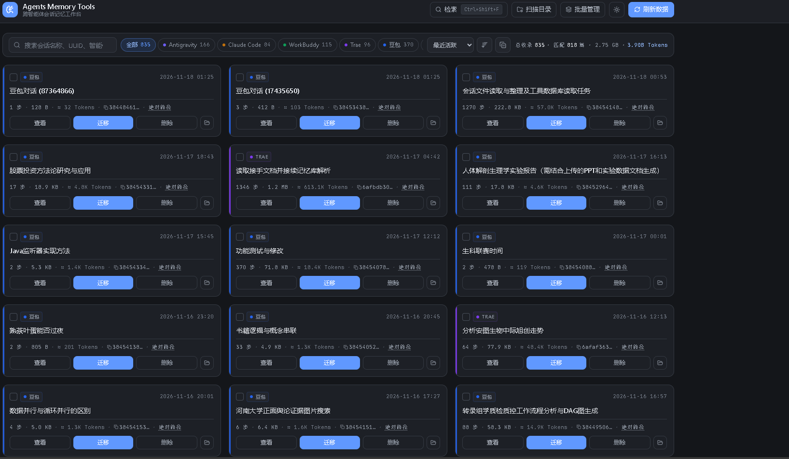
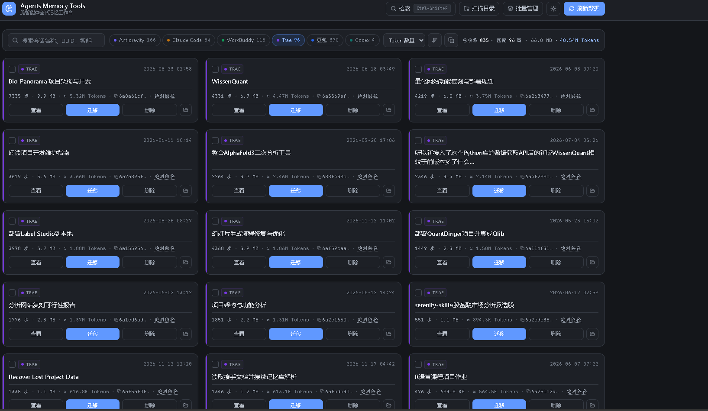
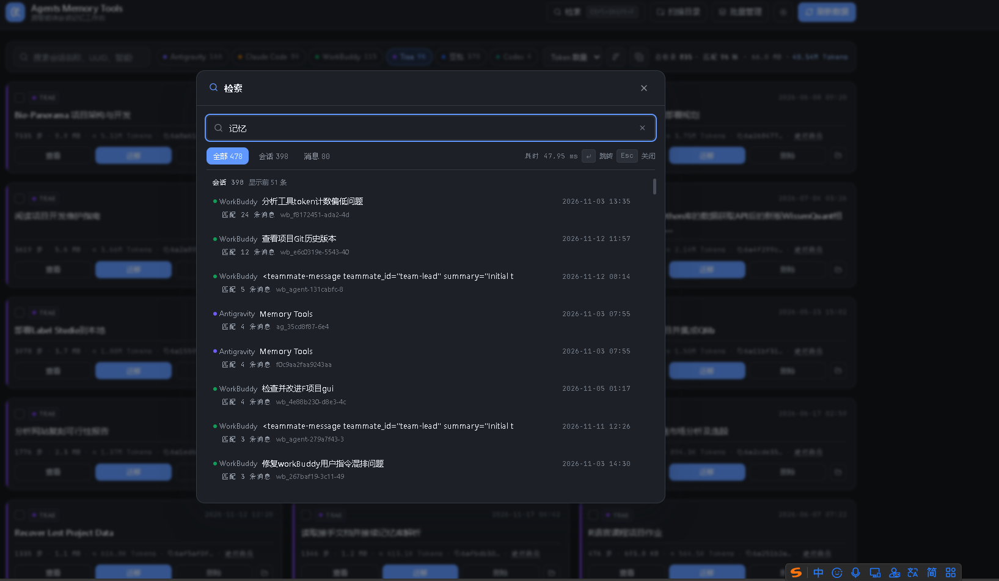
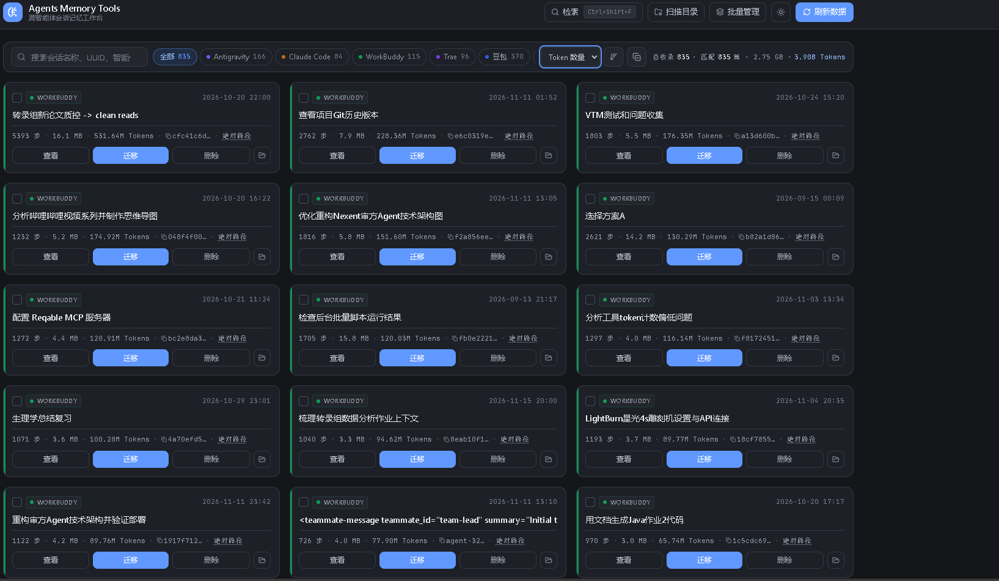
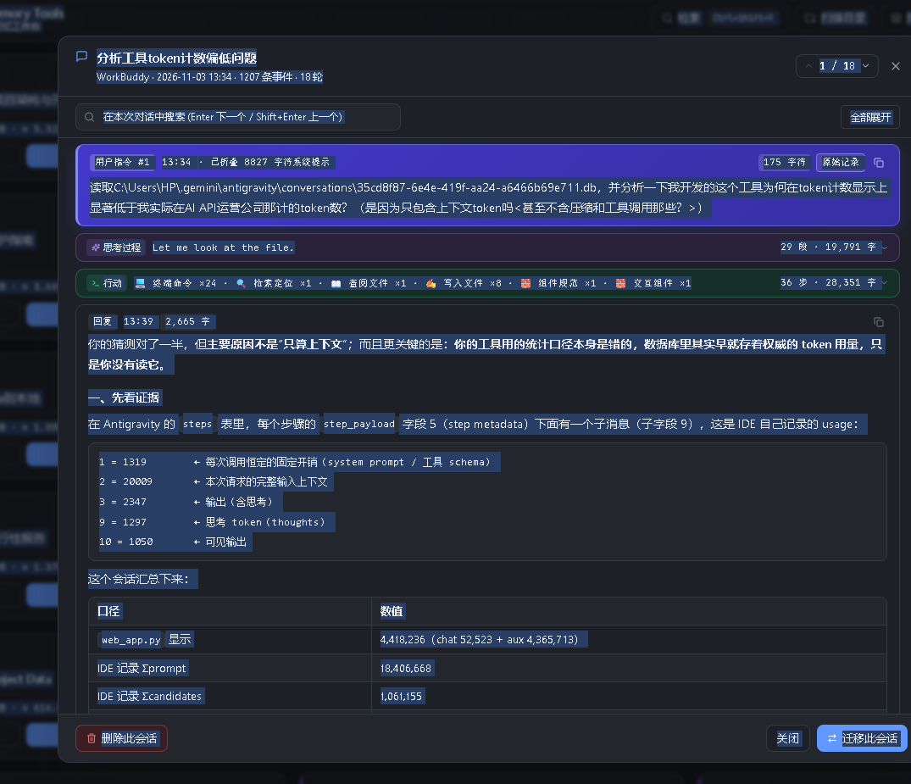
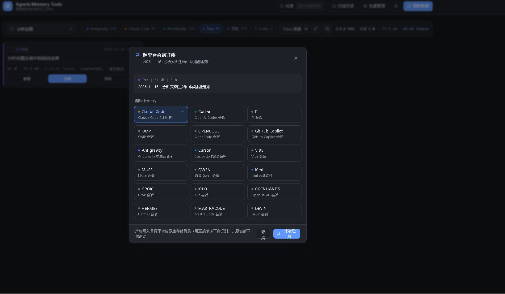
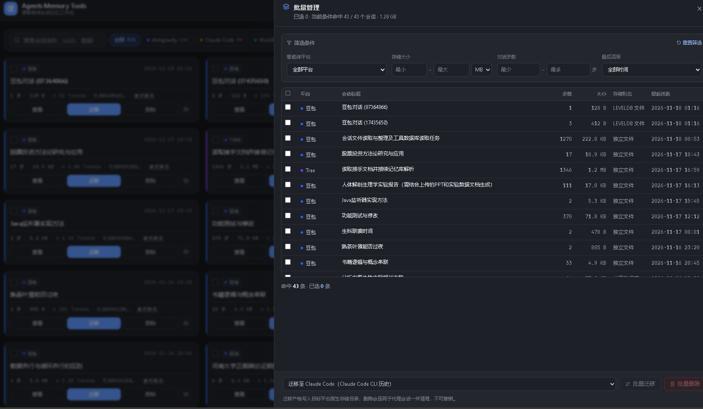
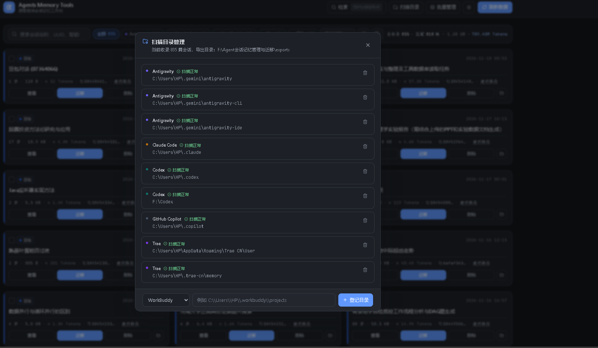

# Memory Tools

<p align="center">
  <strong>跨 IDE 智能体会话检索、记忆归档、Token 审计与格式迁移工具</strong>
</p>

<p align="center">
  <a href="#核心功能演示">核心功能</a> •
  <a href="#为什么开发这个工具">设计背景</a> •
  <a href="#快速上手">快速上手</a> •
  <a href="#多平台会话路径索引指引">路径索引指引</a> •
  <a href="#许可证与开源声明">许可证</a> •
  <a href="README_EN.md">English Documentation</a>
</p>

---

## 为什么开发这个工具

日常开发往往不会只用一个 AI 编程工具。Antigravity、Claude Code、Codex、GitHub Copilot、Trae、WorkBuddy、豆包等产品各自保存会话，底层格式包括 SQLite（`state.vscdb`）、按行分割的 JSONL、分层目录，以及带私有 schema 的状态库。结果很直接：

1. **会话散落在不同目录里**，想把一段调试过程或一套提示词搬到另一个工具，只能重新复制粘贴。
2. **部分 IDE 没有全局历史检索**。会话数量上来以后，想找几周前的一条排错记录，只能翻列表。
3. **格式迁移总有边界情况**。厂商协议更新很快，只靠转换器无法覆盖所有版本；但原始会话文件本身通常还在磁盘上。

Memory Tools 因此采用**双轨设计**：

- **转换轨**：为已适配的平台提供会话格式转换、目标目录写入和独立文件导出。
- **绝对路径直通轨**：为每个会话保留源文件绝对路径，并支持在文件管理器中直接定位。遇到尚未适配的工具，也可以把原始文件交给新的 Agent，绕过格式转换，保留完整上下文。

这个工具不替代 IDE，也不接管你的账号。它做的是把本机已经存在的会话资产整理成一个可检索、可审计、可迁移的本地索引。

---

## 核心功能演示

> 以下截图来自当前工作区的实际界面；不同机器上的平台数量和会话数量会随本地安装情况变化。

### 1. 仪表板 (Dashboard Overview)

启动后自动扫描本地目录，汇总会话总数、平台分布、存储占用和 Token 总量。当前工作区实测索引到 **6 个平台、835 个会话、2.75 GB 会话文件、3.90B Tokens**；顶部同时给出全量 Token 统计。



---

### 2. 按平台筛选 (Platform Filtering)

平台筛选条支持 Antigravity、Claude Code、Codex、GitHub Copilot、WorkBuddy、Trae、豆包等入口，可快速切换平台视图。每张会话卡片展示交互步数、文件体积、Token 估算值、唯一标识和源文件绝对路径。

当平台数量超过一行时，筛选条保持单行横向滚动；鼠标悬停在筛选区域滚动滚轮即可移动条目，不会把工具栏撑成多行。



---

### 3. 检索：会话与消息分开看

顶部检索入口支持跨平台、跨会话的中文全文检索。结果按三个标签归类：

- **全部**：会话命中与消息命中合并展示；
- **会话**：按会话标题、平台和命中次数聚合；
- **消息**：定位到具体会话的具体轮次，适合找一句原话。

检索结果会显示命中会话数、消息数和耗时；在会话详情内还可以继续做单会话检索，使用 `Enter` 跳到下一个命中，`Shift+Enter` 回到上一个。



---

### 4. Token 统计

顶部的 Token 汇总和每张卡片的 Token 数字，优先采用客户端自己写入的真实用量记录：

- Antigravity 读取 `steps.metadata` 中的 `promptTokenCount / candidatesTokenCount`；
- Claude Code 读取每条 assistant 记录的 `message.usage`；
- 没有真实用量记录的平台，回退到 `tiktoken`（`cl100k_base`）做内容体积估算，并在卡片上以 `≈` 标记。

这样既能看“这段记忆有多大”，也能看智能体实际消耗了多少上下文。列表支持按 Token 数量排序；顶部会同时保留全量汇总和当前筛选结果，切换平台后不会把两个口径混在一起。



---

### 5. 规整的会话详情

点击会话卡片进入详情。详情按“用户指令、思考、行动、回复”拆开呈现，工具调用、终端输出、文件操作和 MCP 调用都能在行动区展开查看。

「用户指令」只保留你真正输入的内容：系统注入、时间提醒、任务回执、压缩摘要、CLI 命令、附件标签等会被剥离到独立气泡，并标注过滤字数。整段文件粘贴型的长消息默认折叠，避免一屏被一段日志占满。

同一轮里如果模型先输出中间说明、最后才给出正式答复，详情会把中间消息归入思考或行动，只保留最后一条作为该轮的回复；这样一页不会出现多条看起来互相重复的“回复”。



---

### 6. 会话迁移

迁移向导把源会话转换为目标平台格式。当前版本内置 18 个目标适配器：

`Claude Code`、`Codex`、`PI`、`OMP`、`OpenCode`、`GitHub Copilot`、`Antigravity`、`Cursor`、`Vibe`、`Muse`、`Qwen`、`Kimi`、`Grok`、`Kilo`、`OpenHands`、`Hermes`、`Mastra Code`、`Devin`。

迁移可以直接写入目标平台的用户目录，也可以导出为独立存档。写入前会展示源会话的平台、事件数量、文件大小和目标路径；不支持无损转换的字段会保留为原始事件，避免转换过程静默丢数据。



---

### 7. 会话批量管理

批量管理是独立抽屉，不是简单的多选列表。可以按平台、存储大小（KB/MB）、对话步数、最后活跃时间做交集筛选，再执行批量迁移或批量删除。

批量删除会同时清理该会话在索引中的记录和关联的子 Agent 数据；删除前需要二次确认。批量迁移沿用单会话迁移的写入规则，不会因为数量多就跳过目标路径校验。



---

### 8. 目录扫描与存储管理

扫描目录管理器展示每个平台的物理根目录、扫描状态和当前收录的会话数。默认会识别常见安装位置；自定义安装、便携版或迁移到其他盘的工具，可以在这里手动挂载目录。

当前工作区挂载了 9 个根目录，覆盖 Antigravity 的三套数据目录、Claude Code、Codex 的两个目录、GitHub Copilot，以及 Trae 的两套目录。点击「刷新数据」会重新扫描并更新索引，不需要重启服务。



---

## 快速上手

### 环境要求

- Windows 10/11
- Python 3.10+
- Node.js 20+（只在构建前端工作台时需要）

### 安装运行

```bash
# 1. 克隆代码仓库
git clone https://github.com/WilliamGeek/Agents-Memory-Tools.git
cd Agents-Memory-Tools

# 2. 创建并激活虚拟环境
python -m venv .venv
.venv\Scripts\activate

# 3. 安装依赖
pip install -r requirements.txt

# 4. 构建前端工作台（产物导出到 frontend/out）
cd frontend
npm install
npm run build
cd ..

# 5. 启动统一控制台
python web_app.py
```

启动后访问 `http://127.0.0.1:18922`。Python 服务端在同一端口托管 React 静态工作台和 API，不需要额外启动 Node.js 常驻进程；如果本地还没有前端构建产物，会自动回退到内置基础控制台。

> 💡 **Windows 便捷启动**
> - `启动Memory Tools.cmd`：一键启动，前端产物缺失时自动构建
> - `后台静默启动Memory Tools.vbs`：后台无窗口常驻
> - `停止Memory Tools.cmd`：停止本地服务

---

## 多平台会话路径索引指引

Memory Tools 启动时会扫描常见安装路径。自定义安装目录可以在「扫描目录管理」里手动添加。下面是当前版本常用的 Windows 路径，实际路径以本机安装为准。

### 1. 常见平台存储路径

| 平台 | 常见 Windows 路径 | 主要存储载体 |
| :--- | :--- | :--- |
| **Antigravity IDE** | `%USERPROFILE%\.gemini\antigravity\`、`%USERPROFILE%\.gemini\antigravity-cli\`、`%USERPROFILE%\.gemini\antigravity-ide\` | SQLite / JSONL / `brain/` |
| **Claude Code** | `%USERPROFILE%\.claude\` | `sessions/*.jsonl`、项目历史 |
| **Codex** | `%USERPROFILE%\.codex\` 或自定义工作目录 | `sessions/*.jsonl` |
| **GitHub Copilot** | `%USERPROFILE%\.copilot\`、`%APPDATA%\Code\User\workspaceStorage\` | `state.vscdb` |
| **Trae / Trae CN** | `%APPDATA%\Trae CN\User\`、`%USERPROFILE%\.trae-cn\memory\` | `state.vscdb`、`session_memory_*.jsonl`、加密 `database.db` |
| **WorkBuddy** | `%USERPROFILE%\.workbuddy\projects\` | `*.jsonl`、`subagents/*.jsonl` |
| **豆包** | `%LOCALAPPDATA%\Doubao\User Data\Default\.doubao\agent_mode\workspace\.sessions\` | IndexedDB 元数据、`trajectory.jsonl`；正文可选只读云端同步 |

Trae CN 新版会把部分会话正文写入 `ModularData\ai-agent\database.db` 的加密库。这个库不是普通 SQLite 文件，直接挂载只能看到表结构或空壳数据；需要先用项目内的本地导出流程生成可读快照，再把快照目录加入扫描。不要把数据库密钥、解密产物或含个人正文的缓存提交到公开仓库。

### 2. 使用你的 AI 智能体辅助定位路径

不确定某个 IDE 把会话放在哪里时，可以把下面这段提示词发给当前使用的编程助手：

```text
请帮我排查当前开发环境中，你（当前使用的 AI 编程工具）存放用户历史聊天记录、会话数据库或上下文缓存的具体物理路径。
请重点检查：
1. %USERPROFILE% 下以点开头的隐藏目录（如 .cursor、.claude、.gemini、.codex、.trae-cn 等）；
2. %APPDATA% 和 %LOCALAPPDATA% 下该 IDE 的 workspaceStorage、globalStorage 或 state.vscdb；
3. 输出确认存在的完整绝对路径，并说明对应文件是主数据库、日志还是正文缓存。
```

拿到路径后，在「扫描目录管理」中新增对应根目录，点击「刷新会话数据」即可建立索引。索引只读取文件，不会修改源会话。

### 3. 关于绝对路径索引

Memory Tools 为每条会话保留源文件绝对路径，并在详情页提供「绝对路径」按钮。这个设计的用途不是展示路径，而是让你在格式适配失败时仍有一条退路：直接打开源文件，把原始内容投喂给新的 Agent，或者交给人工检查。

---

## 许可证与开源声明

本项目采用 **[CC BY-NC-SA 4.0（知识共享-署名-非商业性使用-相同方式共享 4.0 国际许可协议）](LICENSE)** 发布。

### 权责简要说明

- **允许**：个人开发者免费学习、本地运行、Fork 代码并进行修改优化；
- **禁止**：未经许可将本项目用于商业运营、闭源打包转售或任何形式的商业盈利；
- **共享**：基于本项目修改并公开的版本，需以相同或兼容的非商业协议继续共享，并保留原项目出处。

项目名称、界面设计与文档由作者维护。引用本项目代码或截图时，请保留仓库链接和版权说明。

### 致谢

- 跨智能体会话迁移的底层抽象参考了 [session-migrate](https://github.com/mizchi/session-migrate)（MIT 许可证），在此向原作者团队表示感谢。
- Token 统计优先采用各客户端自身写入的用量记录，估算回退到 OpenAI `tiktoken`；HuggingFace `tokenizers` 作为可选的开放模型词表支持保留。
