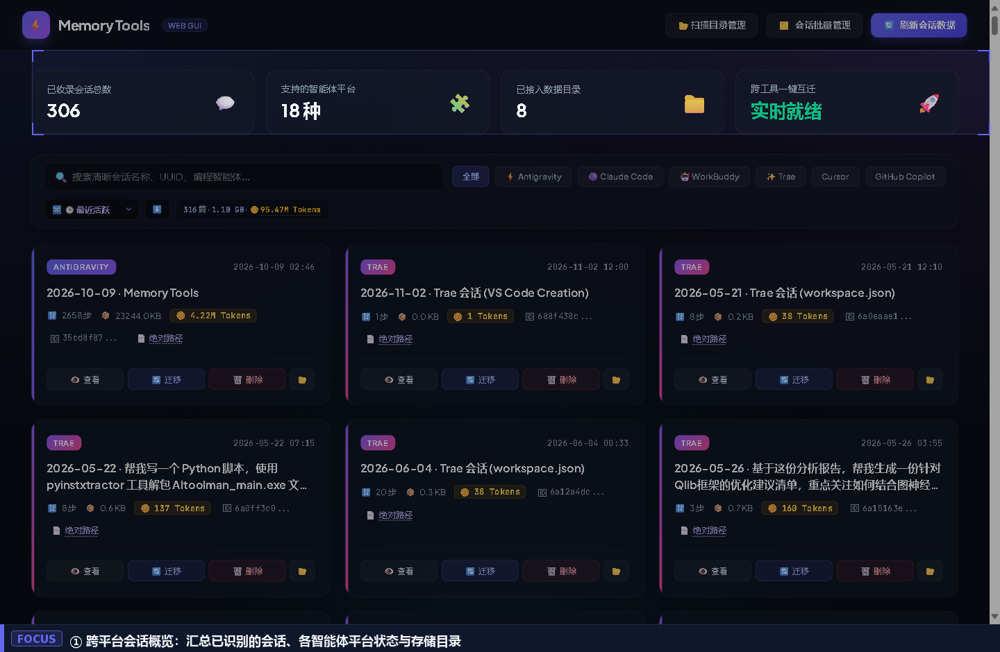
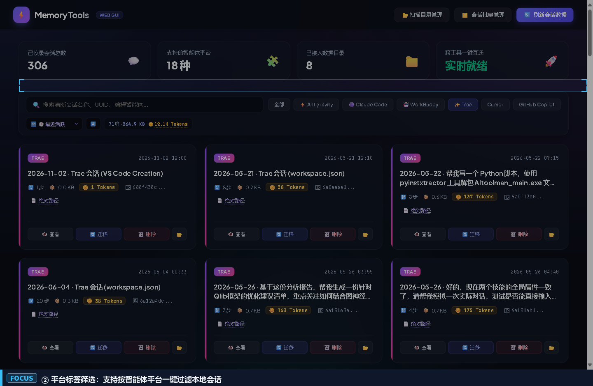
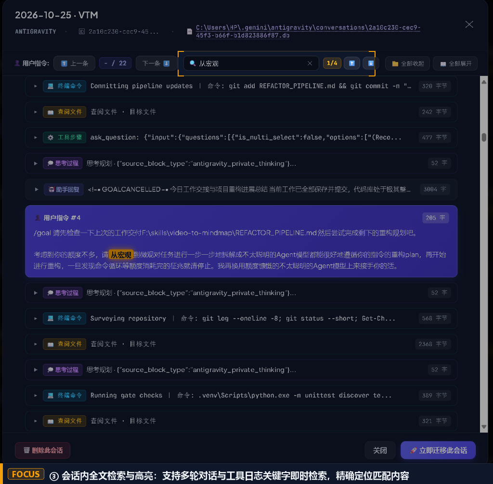
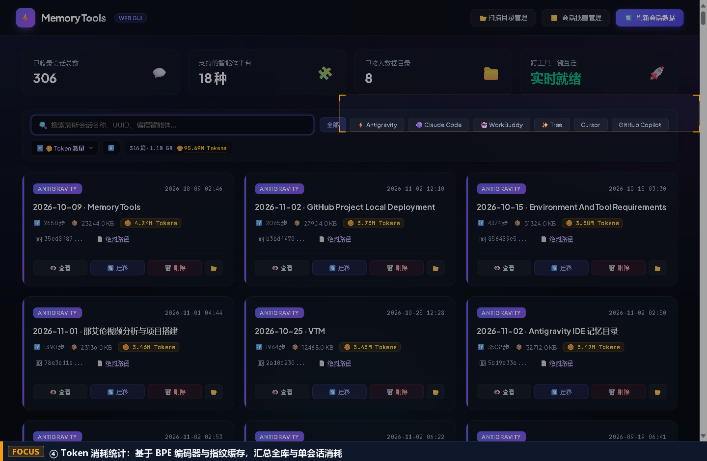
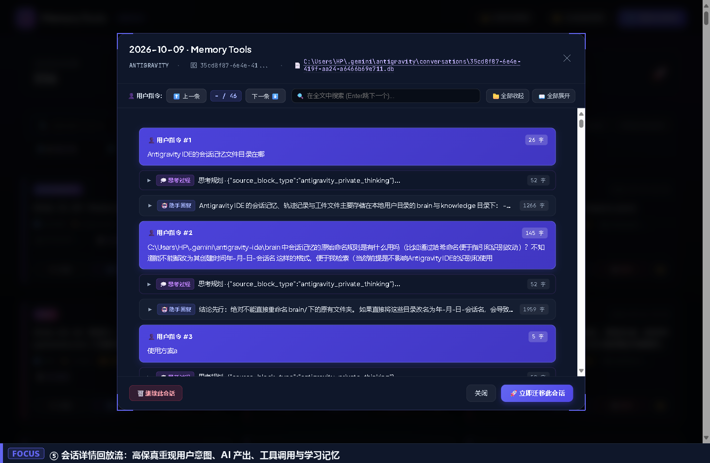
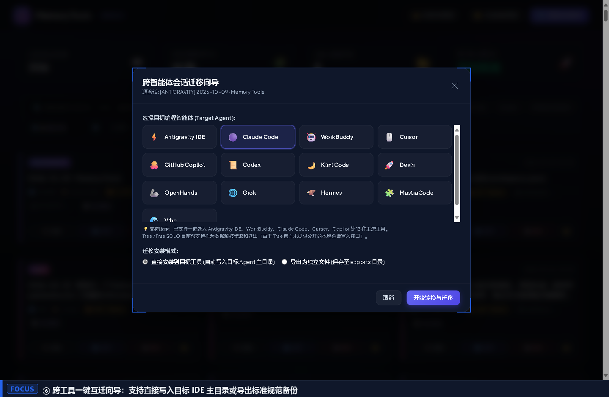
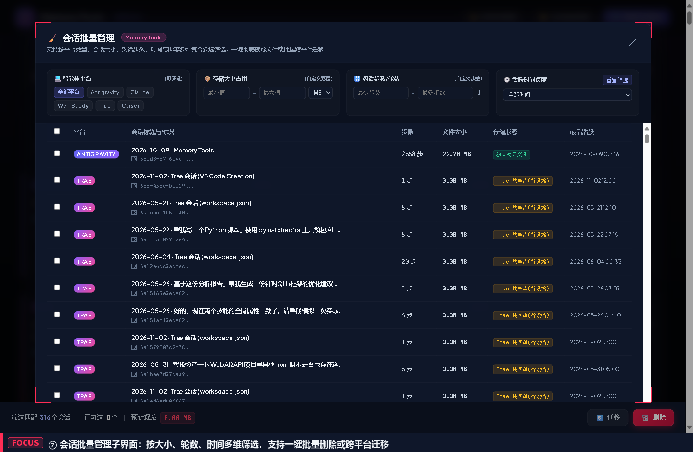
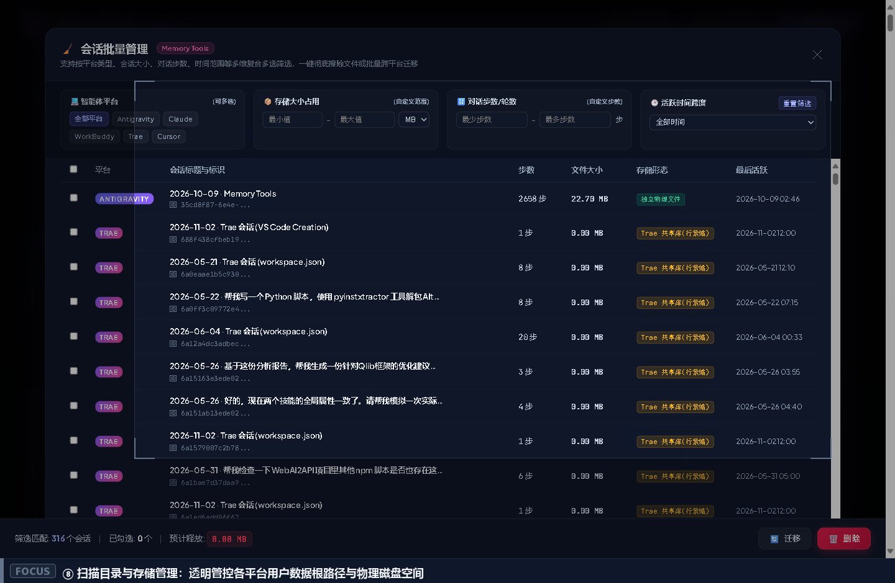

# Memory Tools

<p align="center">
  <strong>跨 IDE 智能体会话检索、记忆归档、Token 审计与格式迁移工具</strong>
</p>

<p align="center">
  <a href="#核心功能演示">核心功能</a> •
  <a href="#为什么开发这个工具">设计背景</a> •
  <a href="#快速上手">快速上手</a> •
  <a href="#多平台会话路径索引指引">路径索引指引</a> •
  <a href="#许可证与开源声明">许可证</a> •
  <a href="README_EN.md">English Documentation</a>
</p>

---

## 为什么开发这个工具

在日常工程实践中，开发者往往同时使用多款 AI 编程助手（如 Antigravity、Cursor、Claude Code、Trae、GitHub Copilot、WorkBuddy 等）。这种异构工作流带来了一系列突出的工程痛点：

1. **会话碎片化与存储异构**：各家工具将会话分别保存在各自的私有目录中，底层格式涵盖 SQLite（`state.vscdb`）、按行分割 JSON（`jsonl`）、层叠目录及专有状态数据库，无法跨工具复用提示词与推理上下文。
2. **官方客户端检索能力缺失**：部分主流 IDE（例如 Antigravity）原生未提供全局历史会话搜索功能，当会话数量达到数百个时，找回过往的关键技术决策与排错记录极其耗时。
3. **跨平台互迁的边界处理**：虽然各工具间存在互迁需求，但由于各厂商协议迭代频繁，单靠自动化转换无法覆盖所有边缘场景。

为此，**Memory Tools** 采用“**双轨设计**”：
- **转换轨**：针对主流工具提供 AST 级别的一键双向转换与目标工作区静默挂载；
- **绝对路径直通轨**：对全量会话提供物理文件绝对路径索引与系统文件管理器一键高亮。即使遇到未经适配的新工具，开发者也可以直接定位底层原始会话文件，投喂给目标智能体进行无损记忆复用。

---

## 核心功能演示

### 1. 仪表板 (Dashboard Overview)
自动扫描本地运行环境，汇总已识别的 18+ 种编程智能体平台、会话总数、数据目录与存储占用。



---

### 2. 按平台筛选 (Platform Filtering)
支持按 Antigravity、Claude Code、Trae、Cursor、Copilot 等平台标签快速过滤，清晰展示每场会话的交互轮数、文件大小与唯一标识符并支持分类多条件检索。



---

### 3. 会话内检索 (Session Search & Locate)
支持在会话详情中对多轮问答、工具执行日志与思考链进行全文关键字检索，即时统计匹配频次并高亮跳转；顶部直接展示物理数据库/文件绝对路径，方便快速定位或提取原始会话。



---

### 4. 精准的Token 消耗统计 (Token Statistics)
集成 `tiktoken`（`cl100k_base`）分词引擎与文件指纹哈希缓存，避免重复全量读取，快速统计各会话与全库的消耗量。支持区分“正文对话”与“工具调用/思考过程”，并支持按 Token 总量对会话排序。



---

### 5. 规整美观的会话内容呈现
点击会话卡片可完整还原多轮对话流。不仅呈现用户输入与模型输出，还能完整解析工具调用（Tool Calls）、执行日志、动作链以及智能体沉淀的学习记忆。



---

### 6. 会话迁移
提供向导式迁移弹窗，支持将指定会话转换为目标工具格式（如将 Antigravity 转换为 Claude Code / Cursor），可直接静默写入目标 IDE 用户目录，或导出为独立标准格式存档。



---

### 7. 会话批量管理
提供独立子控制台，支持以存储大小（KB/MB 自定义范围）、对话步数（片段/中长轮次）、时间跨度（按天/按月过滤）等多维参数交集筛选，支持一键批量跨平台迁移或批量物理删除释放空间。



---

### 8. 目录扫描与存储管理
可视化展示各智能体平台的物理根目录挂载状态、文件总数与磁盘占用体积。支持动态挂载自定义目录并一键执行全库增量重构与索引刷新。



---

## 快速上手

### 环境要求
- Windows 10/11（已完成针对 Windows NTFS 文件锁与 64 位 Inode 溢出的专项适配）
- Python 3.10+

### 安装运行
```bash
# 1. 克隆代码仓库
git clone https://github.com/WilliamGeek/Agents-Memory-Tools.git
cd Agents-Memory-Tools

# 2. 创建并激活虚拟环境
python -m venv .venv
.venv\Scripts\activate

# 3. 安装依赖包
pip install -r requirements.txt
# 或手动安装关键组件:
pip install session-migrate tiktoken tokenizers bottle

# 4. 启动可视化控制台
python web_app.py
```

服务就绪后，将在浏览器中自动打开 `http://127.0.0.1:18922`。

> 💡 **Windows 便捷启动**：
> 目录下已内置两个脚本：
> - `启动Memory Tools.cmd`：控制台交互启动
> - `后台静默启动Memory Tools.vbs`：后台无窗口静默常驻
> - `停止Memory Tools.cmd`：一键终止后台服务

---

## 多平台会话路径索引指引

Memory Tools 启动时会自动尝试扫描系统默认安装路径。若你的环境使用了自定义路径，可通过以下方式快速配置：

### 1. 常见平台默认存储路径对照表

| 平台名称 | 默认存储路径 (Windows) | 存储核心载体 |
| :--- | :--- | :--- |
| **Antigravity IDE** | `%USERPROFILE%\.gemini\antigravity\conversations` | `.pb` / `.jsonl` / `brain/` |
| **Claude Code** | `%USERPROFILE%\.claude.json` 与 `%USERPROFILE%\.claude\` | `sessions/*.jsonl` |
| **Trae / Trae SOLO** | `%APPDATA%\Trae CN\User\` 与 `%USERPROFILE%\.trae-cn\memory` | `state.vscdb` / `session_memory_*.jsonl` |
| **Cursor** | `%APPDATA%\Cursor\User\workspaceStorage\` | `state.vscdb` |
| **GitHub Copilot** | `%APPDATA%\Code\User\workspaceStorage\` | `state.vscdb` |
| **WorkBuddy** | `%USERPROFILE%\.workbuddy\` | `history.jsonl` |

### 2. 使用你的 AI 智能体辅助定位路径

如果你不确定当前 IDE 会话存放在何处，可直接将下方提示词发送给你的本地编程助手（如在 Cursor / Claude Code / Antigravity 中提问）：

```text
请帮我排查当前开发环境中，你（当前使用的AI编程工具）存放用户历史聊天记录、会话数据库或上下文缓存的具体物理路径。
请重点检查：
1. %USERPROFILE% 下以点开头的隐藏目录（如 .cursor, .claude, .gemini 等）；
2. %APPDATA% 和 %LOCALAPPDATA% 下该 IDE 的 workspaceStorage 或 globalStorage/state.vscdb；
3. 输出确认存在的完整绝对路径，方便我将其挂载到外部会话管理工具中。
```

获取路径后，只需在 Memory Tools 顶部的「**📂 扫描目录管理**」面板中添加对应文件夹，点击「刷新会话数据」即可全量载入。

---

## 许可证与开源声明

本项目采用 **[CC BY-NC-SA 4.0 (知识共享-署名-非商业性使用-相同方式共享 4.0 国际许可协议)](LICENSE)** 发布。

### 权责简要说明
- **允许**：个人开发者可免费学习、本地运行、Fork 代码并进行优化定制；
- **禁止**：严禁未经许可将本项目用于商业运营、闭源打包转售或任何形式的商业盈利行为；
- **共享**：任何基于本项目衍生修改并公开的版本，必须以相同或兼容的非商业协议继续开源。

### 致谢 (Acknowledgments)
- 跨智能体会话迁移底层抽象参考了 [session-migrate](https://github.com/mizchi/session-migrate)（MIT 许可证），在此向原作者团队表示感谢。
- 高性能 Token 编码与分词依赖 OpenAI `tiktoken` 及 HuggingFace `tokenizers` 库。
