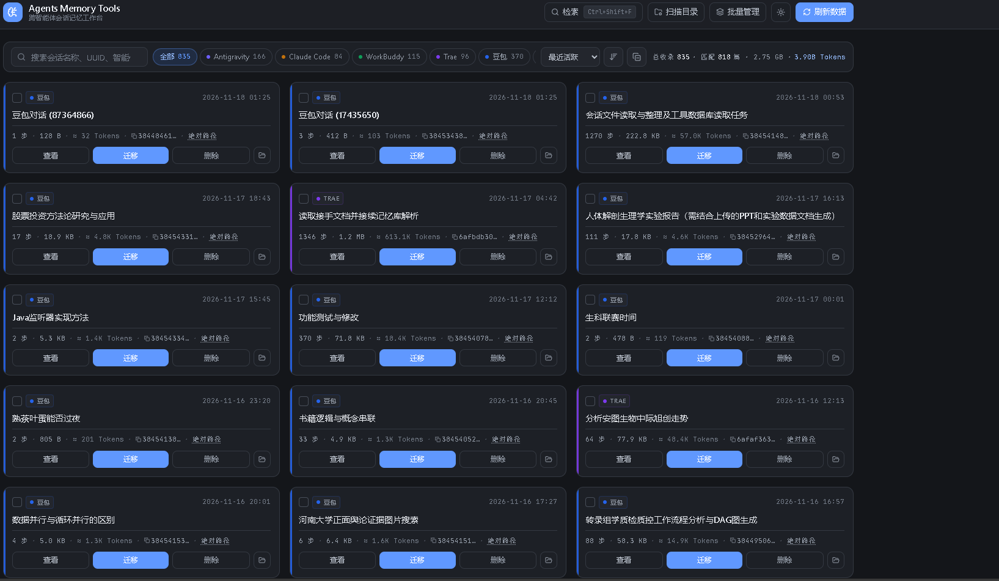
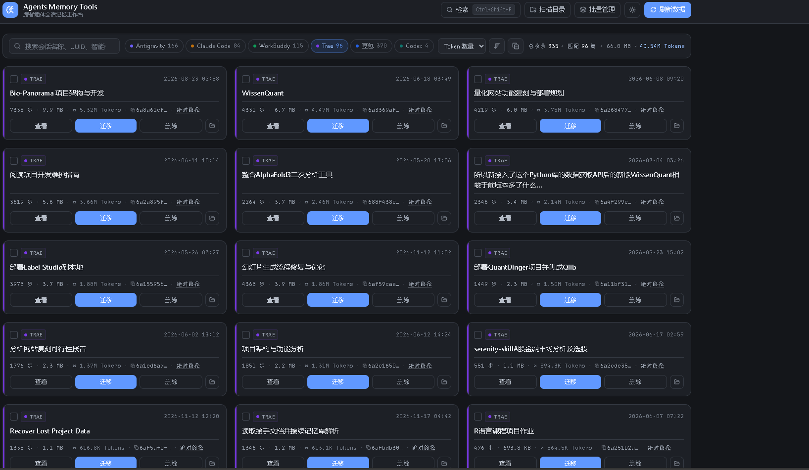
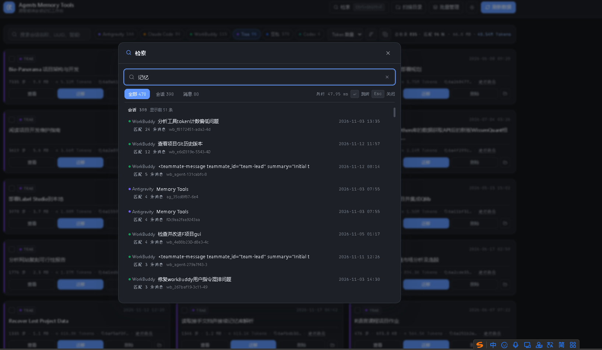
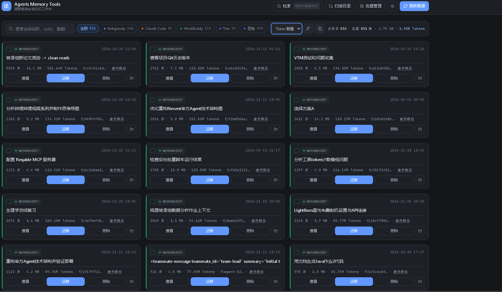
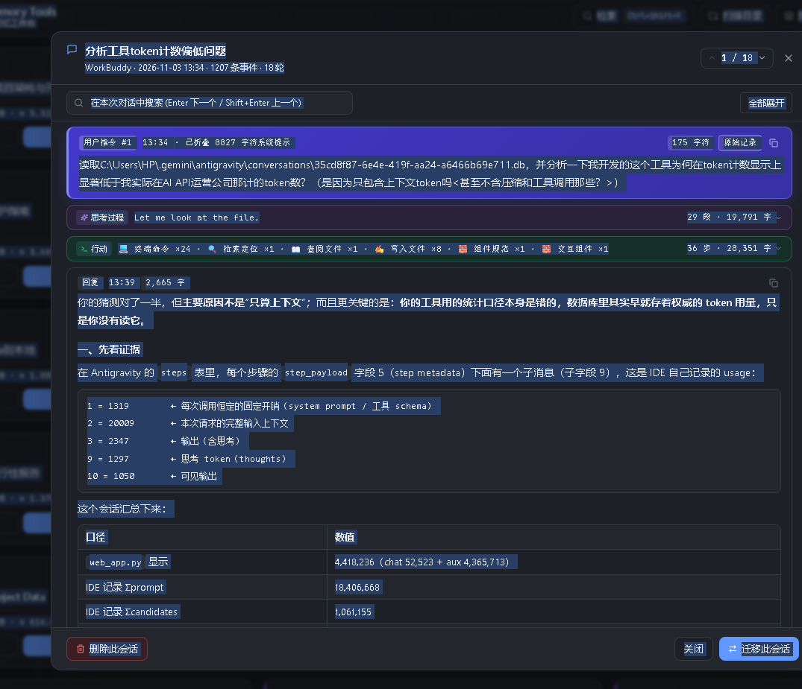
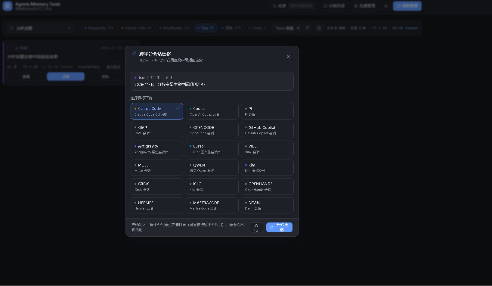
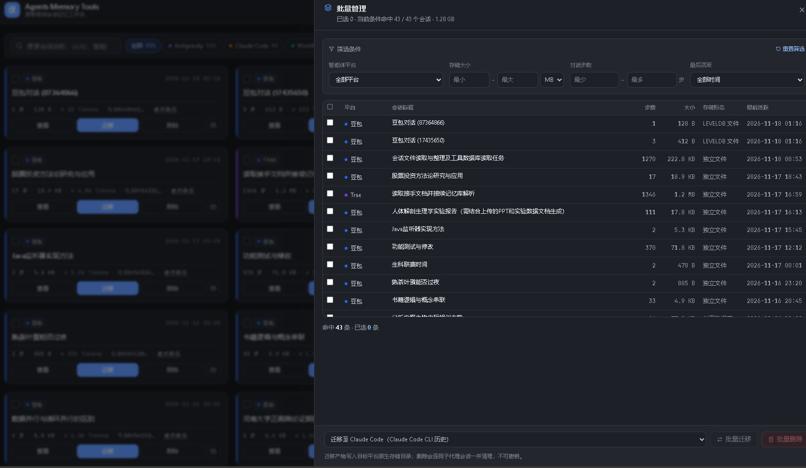
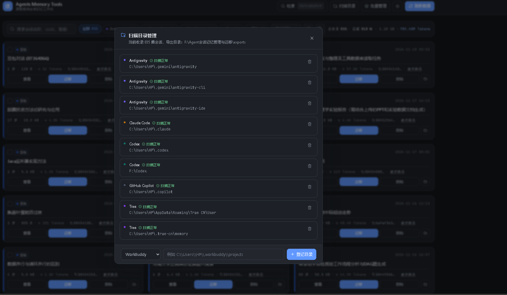

# Memory Tools

<p align="center">
  <strong>Cross-IDE AI Session Search, Memory Archiving, Token Auditing & Format Migration</strong>
</p>

<p align="center">
  <a href="#core-features">Features</a> •
  <a href="#background--design-rationale">Design Rationale</a> •
  <a href="#getting-started">Getting Started</a> •
  <a href="#session-path-discovery-guide">Path Discovery</a> •
  <a href="#license--acknowledgments">License</a> •
  <a href="README.md">简体中文</a>
</p>

---

## Background & Design Rationale

Most developers do not use a single AI coding assistant. Antigravity, Claude Code, Codex, GitHub Copilot, Trae, WorkBuddy, Doubao and others each keep their own session store: SQLite (`state.vscdb`), line-delimited JSONL, nested folders, or a private schema.

That creates three practical problems:

1. **Sessions are scattered.** Moving a debugging trace or a reusable prompt to another tool usually means copy-paste.
2. **Some IDEs have no global history search.** Once a few hundred sessions accumulate, finding a decision or an old fix turns into manual scrolling.
3. **Format conversion has limits.** Vendor protocols change faster than converters can follow. The original session file, however, is usually still on disk.

Memory Tools uses a **dual-track design**: the conversion track writes format-aware output into supported target directories; the absolute-path track keeps every session’s source file path, so an unsupported format can still be handed to another agent without conversion.

It does not replace the IDE or take over your accounts. It turns local sessions into a searchable, portable index.

---

## Core Features

> The screenshots below are from the current workspace. Platform and session counts depend on what is installed on each machine.

### 1. Dashboard Overview

On startup, the workbench scans configured roots and summarizes platform distribution, session count, storage size, and token totals. The current workspace indexes **6 platforms, 835 sessions, 2.75 GB of session files, and 3.90B tokens**.



---

### 2. Platform Filtering

The platform strip provides entries for Antigravity, Claude Code, Codex, GitHub Copilot, WorkBuddy, Trae, and Doubao. Each session card shows steps, file size, estimated tokens, a stable identifier, and the absolute source path.



---

### 3. Search: Sessions and Messages

Global full-text search supports Chinese and English content across platforms. Results are split into three tabs:

- **All**: session hits and message hits together;
- **Sessions**: grouped by session title, platform, and hit count;
- **Messages**: exact turns inside a session, useful when you remember a sentence rather than a title.

The result header reports session hits, message hits, and elapsed time. Session details also have an in-session search field: `Enter` jumps to the next match, `Shift+Enter` goes back.



---

### 4. Token Statistics

Token numbers prefer usage recorded by the client itself:

- Antigravity reads `promptTokenCount / candidatesTokenCount` from `steps.metadata`;
- Claude Code reads `message.usage` on assistant records;
- platforms without recorded usage fall back to `tiktoken` (`cl100k_base`) content-size estimation, marked with `≈` on the card.

This separates “the size of this memory” from “what the agent actually consumed”. The list supports sorting by token quantity; the header keeps both the global total and the current filtered total.



---

### 5. Structured Session Detail

Open a session to see the full timeline split into user instruction, thinking, actions, and reply. Tool calls, terminal output, file operations, and MCP calls are available inside the action blocks.

The user instruction shown is the text actually typed by the user. Injected system context, time reminders, task receipts, compaction summaries, CLI commands, and attachment wrappers are moved into separate bubbles with a filtered-character count. Long pasted files collapse by default.

If a turn contains intermediate assistant messages before the final answer, those intermediate messages are demoted into thinking/action; only the final message remains as the reply. That prevents several near-identical “replies” from appearing for one user instruction.



---

### 6. Session Migration

The migration wizard converts a source session into a target format. The current build has 18 target adapters:

`Claude Code`, `Codex`, `PI`, `OMP`, `OpenCode`, `GitHub Copilot`, `Antigravity`, `Cursor`, `Vibe`, `Muse`, `Qwen`, `Kimi`, `Grok`, `Kilo`, `OpenHands`, `Hermes`, `Mastra Code`, `Devin`.

A session can be written into the target platform's user directory or exported as a standalone archive. Before writing, the wizard shows the source platform, event count, file size, and destination; fields that cannot be converted losslessly stay as raw events instead of being dropped.



---

### 7. Batch Management

Batch management is a separate drawer with filters for platform, storage size (KB/MB), turn count, and last-activity window. Filtered sets can be migrated or deleted in bulk.

Batch deletion also removes the associated index records and sub-agent records; it requires confirmation. Batch migration uses the same destination checks as the single-session flow.



---

### 8. Directory Scan & Storage Management

The directory manager lists each platform's physical root, scan status, and indexed session count. Default installation paths are detected automatically; portable installs or custom drives can be mounted manually.

The current workspace has nine roots covering three Antigravity data folders, Claude Code, two Codex roots, GitHub Copilot, and two Trae folders. “Refresh data” re-scans and updates the index without restarting the service.



---

## Getting Started

### Prerequisites

- Windows 10/11
- Python 3.10+
- Node.js 20+ (only for building the frontend)

### Setup & Launch

```bash
# 1. Clone the repository
git clone https://github.com/WilliamGeek/Agents-Memory-Tools.git
cd Agents-Memory-Tools

# 2. Create and activate a virtual environment
python -m venv .venv
.venv\Scripts\activate

# 3. Install dependencies
pip install -r requirements.txt

# 4. Build the frontend workbench (exports to frontend/out)
cd frontend
npm install
npm run build
cd ..

# 5. Start the single-port service
python web_app.py
```

Open `http://127.0.0.1:18922`. The Python server hosts both the exported React workbench and the API on one port; no extra Node.js daemon or proxy is required. If the frontend export is missing, the built-in console is used as a fallback.

> **Windows shortcut**
> - Double-click `启动Memory Tools.cmd` to launch in the foreground; the frontend is built automatically when missing.
> - Closing the terminal window stops the service and releases its processes; no separate stop script is needed.

---

## Session Path Discovery Guide

Memory Tools scans common installation paths at startup. For custom installations, add the directory in the Directory Manager. The paths below are typical Windows locations; use the ones that actually exist on your machine.

### 1. Default Storage Locations

| Assistant | Typical Windows Path | Primary Storage |
| :--- | :--- | :--- |
| **Antigravity IDE** | `%USERPROFILE%\.gemini\antigravity\`, `%USERPROFILE%\.gemini\antigravity-cli\`, `%USERPROFILE%\.gemini\antigravity-ide\` | SQLite / JSONL / `brain/` |
| **Claude Code** | `%USERPROFILE%\.claude\` | `sessions/*.jsonl`, project history |
| **Codex** | `%USERPROFILE%\.codex\` or a custom working directory | `sessions/*.jsonl` |
| **GitHub Copilot** | `%USERPROFILE%\.copilot\`, `%APPDATA%\Code\User\workspaceStorage\` | `state.vscdb` |
| **Trae / Trae CN** | `%APPDATA%\Trae CN\User\`, `%USERPROFILE%\.trae-cn\memory\` | `state.vscdb`, `session_memory_*.jsonl`, encrypted `database.db` |
| **WorkBuddy** | `%USERPROFILE%\.workbuddy\projects\` | `*.jsonl`, `subagents/*.jsonl` |
| **Doubao** | `%LOCALAPPDATA%\Doubao\User Data\Default\.doubao\agent_mode\workspace\.sessions\` | IndexedDB metadata, `trajectory.jsonl`; optional read-only cloud sync |

Trae CN writes part of its session body into the encrypted `ModularData\ai-agent\database.db`. That file is not a normal SQLite database; mounting it directly only reveals table structure or empty shells. Export a readable snapshot locally first, then add that snapshot directory to the scanner. Do not commit keys, decrypted databases, or caches containing personal conversation content.

### 2. Ask Your Local Agent for Paths

If you are unsure where an IDE stores its sessions, send this prompt to the assistant you are currently using:

```text
Inspect the current development environment and identify where you (the current AI coding tool) store local user conversation history, session databases, and context caches.
Check specifically:
1. Dot-prefixed hidden folders under %USERPROFILE% (for example .cursor, .claude, .gemini, .codex, .trae-cn);
2. workspaceStorage, globalStorage, or state.vscdb under %APPDATA% and %LOCALAPPDATA%;
3. Return the confirmed absolute paths and state whether each file is the main database, a log, or a transcript cache.
```

After collecting the paths, add the root in **Directory Manager** and click **Refresh Session Data**. Indexing is read-only; source sessions are not modified.

### 3. Why Absolute Paths Matter

Every session keeps its source file path, and the detail view exposes a **Reveal Path** action. This is not cosmetic: when format conversion fails, the raw file remains a reliable fallback. You can open it, hand it to another agent, or inspect it manually.

---

## License & Acknowledgments

This project is licensed under **[CC BY-NC-SA 4.0 (Creative Commons Attribution-NonCommercial-ShareAlike 4.0 International)](LICENSE)**.

### Summary of Terms

- **Permitted**: individual developers may study, run locally, fork, and modify the codebase for personal use;
- **Prohibited**: commercial exploitation, paid packaging, or proprietary redistribution without permission;
- **ShareAlike**: public derivatives must remain under the same or a compatible non-commercial license and retain attribution.

The project name, interface design, and documentation are maintained by the author. When reusing code or screenshots, keep the repository link and copyright notice.

### Acknowledgments

- Underlying migration abstractions reference [session-migrate](https://github.com/mizchi/session-migrate) (MIT License); thanks to its authors.
- Token figures prefer usage records written by each client, with OpenAI `tiktoken` as the fallback estimator. The optional HuggingFace `tokenizers` dependency is retained for open-model vocabularies.
