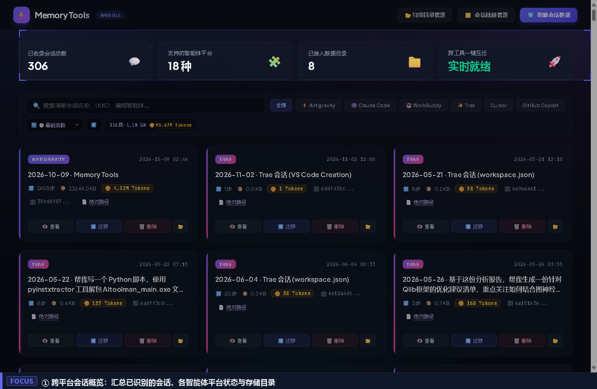
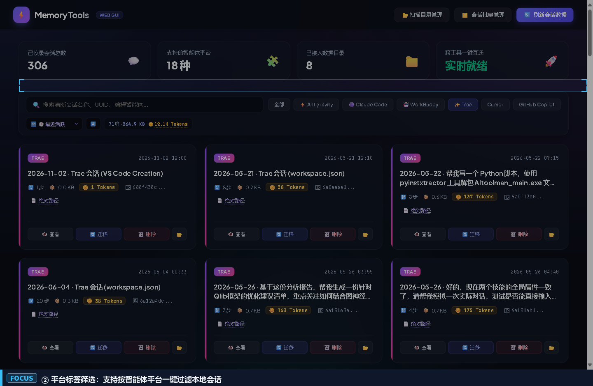
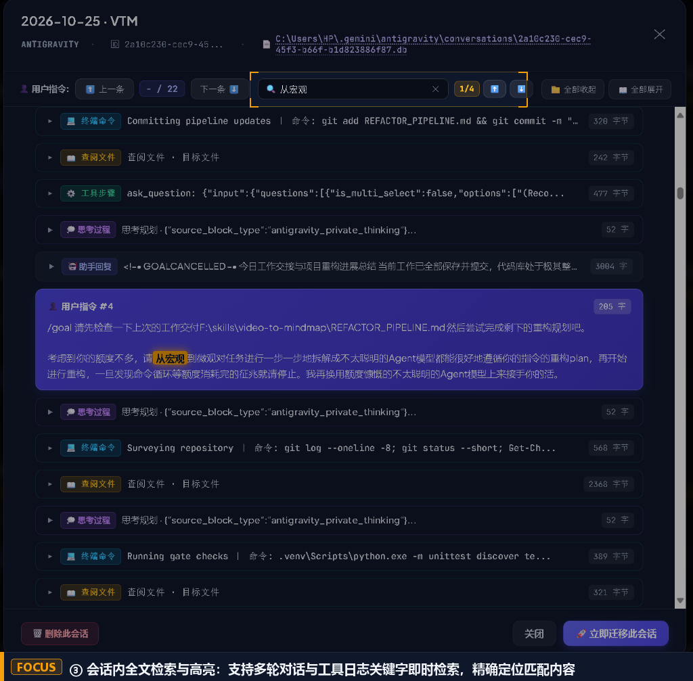
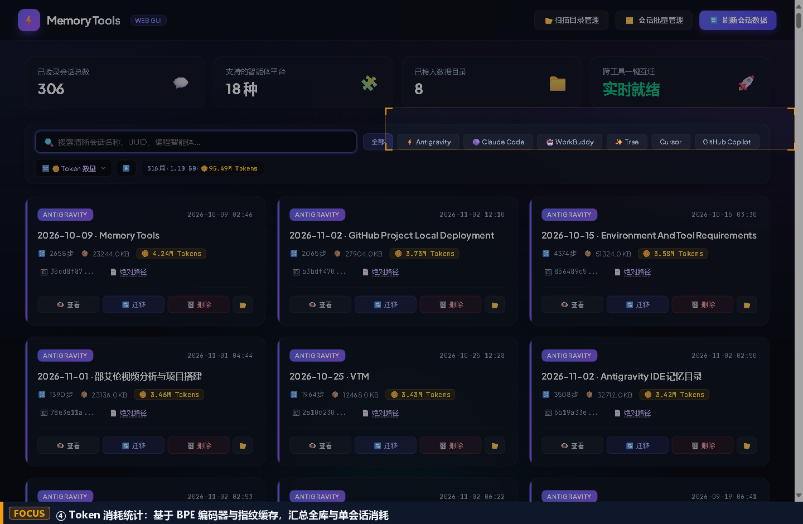
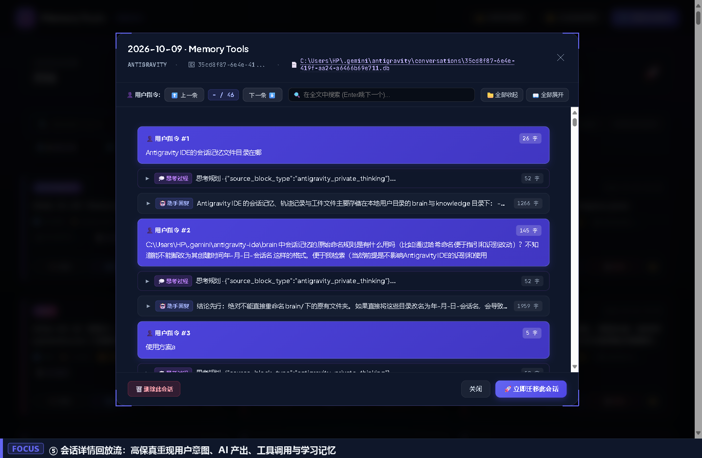
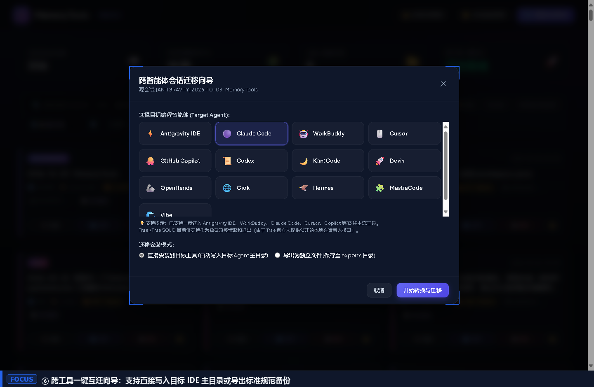
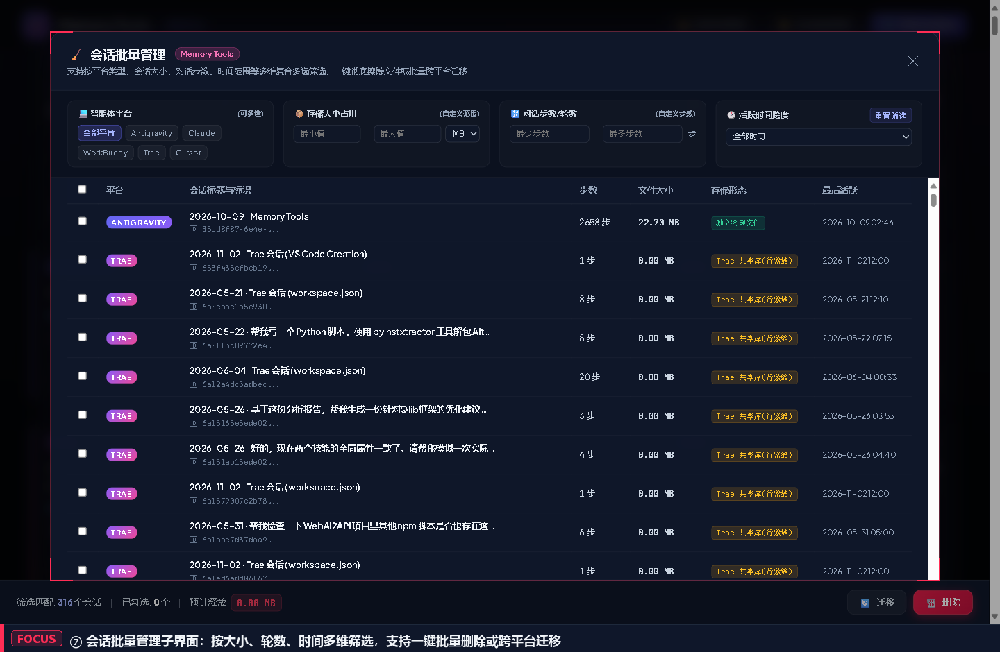
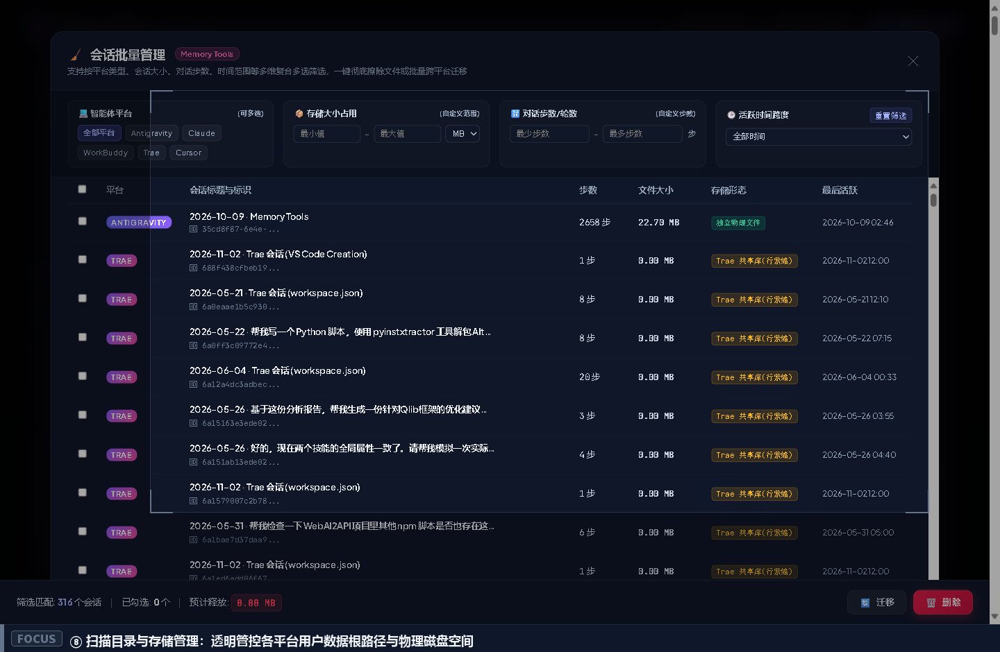

# Memory Tools

<p align="center">
  <strong>Cross-IDE AI Coding Session Search, Memory Archiving, Token Auditing & Format Migration</strong>
</p>

<p align="center">
  <a href="#core-features">Features</a> •
  <a href="#background--design-rationale">Design Rationale</a> •
  <a href="#getting-started">Getting Started</a> •
  <a href="#session-path-discovery-guide">Path Discovery</a> •
  <a href="#license--acknowledgments">License</a> •
  <a href="README.md">简体中文</a>
</p>

---

## Background & Design Rationale

Modern software development frequently involves multiple AI coding assistants (such as Antigravity, Cursor, Claude Code, Trae, GitHub Copilot, and WorkBuddy). This heterogeneous workflow creates several recurring engineering headaches:

1. **Session Fragmentation & Format Heterogeneity**: Assistants store sessions in isolated directories using disparate formats—ranging from SQLite databases (`state.vscdb`) and line-delimited JSON (`jsonl`) to layered directory structures and proprietary state stores. Reusing prompts, reasoning chains, and historical fixes across tools is difficult.
2. **Lack of Global Search in Official IDEs**: Several mainstream environments (notably Antigravity) provide no built-in global search across past conversation histories. When session counts reach hundreds, locating past technical decisions or diagnostic solutions requires tedious manual browsing.
3. **Edge Cases in Automated Format Conversion**: While migration between tools is desirable, vendor protocols evolve rapidly. Pure automated AST translation inevitably hits format mismatches on edge cases.

To address these issues, **Memory Tools** adopts a **dual-track design**:
- **Conversion Track**: Native AST-level schema translation and silent target workspace mounting for supported environments;
- **Absolute Path Track**: Direct physical file indexing and one-click revelation in the system file manager. When interacting with an unsupported or experimental agent, developers can bypass conversion altogether, grab the raw session transcript directly from disk, and feed it straight into the new agent without data loss.

---

## Core Features

### 1. Dashboard Overview
Scans the local environment, summarizing recognized coding assistant platforms, session totals, directories, and storage footprints.



---

### 2. Platform Filtering
Filter conversations by assistant tags (Antigravity, Claude Code, Trae, Cursor, Copilot, etc.). Each card displays message count, disk size, and unique identifiers, with multi-condition classification and search.



---

### 3. In-Session Search (Session Search & Locate)
Full-text search across dialogue turns, tool call logs, and reasoning blocks within session details. Real-time match counting, next/previous navigation, and keyword highlighting, paired with physical database path display for immediate file access.



---

### 4. Accurate Token Usage Statistics
Combines the `tiktoken` (`cl100k_base`) BPE tokenizer with file-fingerprint caching to avoid redundant scans and calculate usage across individual sessions and the overall catalog. Differentiates between core conversation text and tool invocation/reasoning overhead, with sorting by token volume.



---

### 5. Structured & Clean Dialogue Stream
Expand any session to inspect full chronological dialogue flows. Accurately reconstructs user prompts, model responses, tool call payloads, terminal execution logs, and learned agent memory.



---

### 6. Session Migration Wizard
Step-by-step wizard to convert sessions into target platform formats (e.g., Antigravity to Claude Code or Cursor). Supports both direct installation into the target IDE directory and standalone JSON export.



---

### 7. Batch Session Management
A dedicated batch management sub-UI. Filter sessions through intersections of file size (KB/MB thresholds), dialogue step ranges, and historical activity windows, then perform batch migrations or physical deletions to free disk space.



---

### 8. Directory Scan & Storage Management
Visual breakdown of mounted storage root paths, total indexed files, and physical disk usage per platform. Supports dynamically adding custom directories and executing one-click catalog re-indexing.



---

## Getting Started

### Prerequisites
- Windows 10/11 (includes native patches for Windows NTFS file locking and 64-bit Inode overflow)
- Python 3.10+

### Setup & Launch
```bash
# 1. Clone repository
git clone https://github.com/WilliamGeek/Agents-Memory-Tools.git
cd Agents-Memory-Tools

# 2. Create virtual environment
python -m venv .venv
.venv\Scripts\activate

# 3. Install dependencies
pip install -r requirements.txt
# Or manually install core packages:
pip install session-migrate tiktoken tokenizers bottle

# 4. Launch web dashboard
python web_app.py
```

Once running, navigate to `http://127.0.0.1:18922` in your browser.

> 💡 **Windows Shortcuts**:
> - `启动Memory Tools.cmd`: Interactive terminal launch
> - `后台静默启动Memory Tools.vbs`: Headless background daemon
> - `停止Memory Tools.cmd`: Graceful termination of port 18922 processes

---

## Session Path Discovery Guide

Memory Tools scans default installation paths on startup. If your tools use non-standard installation directories, configure them as follows:

### 1. Default Storage Locations

| Assistant | Default Windows Path | Primary Storage Type |
| :--- | :--- | :--- |
| **Antigravity IDE** | `%USERPROFILE%\.gemini\antigravity\conversations` | `.pb` / `.jsonl` / `brain/` |
| **Claude Code** | `%USERPROFILE%\.claude.json` and `%USERPROFILE%\.claude\` | `sessions/*.jsonl` |
| **Trae / Trae SOLO** | `%APPDATA%\Trae CN\User\` and `%USERPROFILE%\.trae-cn\memory` | `state.vscdb` / `session_memory_*.jsonl` |
| **Cursor** | `%APPDATA%\Cursor\User\workspaceStorage\` | `state.vscdb` |
| **GitHub Copilot** | `%APPDATA%\Code\User\workspaceStorage\` | `state.vscdb` |
| **WorkBuddy** | `%USERPROFILE%\.workbuddy\` | `history.jsonl` |

### 2. Prompting Your Local AI Agent for Paths

If you are unsure where your IDE stores its data, send the following prompt to your assistant (within Cursor, Claude Code, or Antigravity):

```text
Please inspect the current environment to identify where you (this AI coding tool) store local user conversation history, session databases, and context logs.
Specifically check:
1. Dotfiles and hidden folders under %USERPROFILE% (e.g., .cursor, .claude, .gemini);
2. Relevant workspaceStorage or globalStorage/state.vscdb inside %APPDATA% and %LOCALAPPDATA%;
3. Return the confirmed absolute directory paths so I can mount them in an external session manager.
```

Once discovered, add the path under the **📂 扫描目录管理** (Directory Management) modal in Memory Tools and click **刷新会话数据** (Refresh Session Data).

---

## License & Acknowledgments

This project is licensed under **[CC BY-NC-SA 4.0 (Creative Commons Attribution-NonCommercial-ShareAlike 4.0 International)](LICENSE)**.

### Summary of Terms
- **Permitted**: Individual developers may freely study, run locally, fork, and modify the codebase for personal use.
- **Prohibited**: Commercial exploitation, packaging for paid distribution, or proprietary redistribution without permission.
- **ShareAlike**: Derivative works and public modifications must remain under the same or a compatible non-commercial license.

### Acknowledgments
- Underlying migration protocols reference [session-migrate](https://github.com/mizchi/session-migrate) (MIT License).
- Token calculations leverage OpenAI's `tiktoken` and HuggingFace's `tokenizers`.
