# Agents Memory Tools · 桌面端工作逻辑架构

> **拓扑概览**：Tauri 2 外壳 + PyInstaller sidecar + 本地会话索引；节点同时标注代码锚点与测试入口 | **渲染模式**：`blueprint` | **规模**：19 节点 · 20 路径

## 一、 全景拓扑图 (Mermaid 同步版)

```mermaid
flowchart LR
  classDef endpoint fill:#083344,stroke:#06b6d4,stroke-width:2.5px,color:#67e8f9;
  classDef action fill:#0c4a6e,stroke:#38bdf8,stroke-width:2px,color:#fff;
  classDef gate fill:#134e4a,stroke:#14b8a6,stroke-width:2px,color:#2dd4bf;
  classDef fallback fill:#422006,stroke:#eab308,stroke-width:2px,stroke-dasharray: 5 5,color:#fde047;
  classDef artifact fill:#3b0764,stroke:#c084fc,stroke-width:2px,color:#e9d5ff;
  classDef human fill:#064e3b,stroke:#10b981,stroke-width:2px,color:#6ee7b7;
  classDef block fill:#450a0a,stroke:#ef4444,stroke-width:2px,color:#fca5a5;

  subgraph S0 ["S0 · 启动、单实例与本地门禁"]
    Start["桌面启动: agents-memory-tools-desktop.exe"]:::endpoint
    G_Single["门禁: Tauri 单实例"]:::gate
    F_Existing["降级: 聚焦已有桌面窗口"]:::fallback
    A_Tauri["Tauri setup: 注入父 PID 并启动 sidecar"]:::action
    A_Paths["运行路径解析: 资源只读 / 用户数据可写"]:::action
    G_Bind["门禁: sidecar 单实例 + 回环端口"]:::gate
    X_Bind["阻断: 端口被占用 → return 1"]:::block
    A_HTTP["HTTP 服务: 静态工作台 + JSON API"]:::action
  end
  subgraph S1 ["S1 · 采集、平台适配与快照"]
    A_Warm["快照预热: _warm_snapshot"]:::action
    A_Catalog["Catalog 根目录 + 增量扫描"]:::action
    A_Adapters["平台适配器: collect_all_sessions"]:::action
    F_Async["降级: Trae 重解密 / 豆包云端同步后台跑"]:::fallback
  end
  subgraph S2 ["S2 · FTS 索引、API 与缓存"]
    A_Snapshot["SnapshotCache: 内容指纹 + single-flight"]:::action
    A_FTS["FTS5 增量索引: SessionFTSManager"]:::action
    A_API["API 路由与缓存: 列表 / 详情 / 检索 / 管理"]:::action
  end
  subgraph S3 ["S3 · 工作台、测试验收与发布"]
    A_UI["Next.js 工作台: SWR 分页与交互"]:::action
    H_Test["测试实例化与验收: .testdata + 回归矩阵"]:::human
    Deliver["交付: Tauri 桌面窗口 + 发布套件"]:::endpoint
    A_Release["发布物料: setup + portable + 校验清单"]:::artifact
  end

  Start -- "启动入口" --> G_Single
  G_Single -- "无现有实例" --> A_Tauri
  G_Single -. "已有实例" .-> F_Existing
  F_Existing -. "聚焦原窗口，复用服务" .-> A_UI
  A_Tauri -- "注入父 PID 后解析路径" --> A_Paths
  A_Paths -- "DATA_DIR / RESOURCE_DIR 就绪" --> G_Bind
  G_Bind -- "锁 + 18923 绑定成功" --> A_HTTP
  G_Bind -- "OSError / 端口冲突" --> X_Bind
  A_HTTP -- "serve_forever 启动后预热" --> A_Warm
  A_Warm -- "快照命中 / 后台重建" --> A_Catalog
  A_Catalog -- "roots + catalog 行" --> A_Adapters
  A_Adapters -- "统一 SessionItem" --> A_Snapshot
  A_Adapters -. "Trae 源库更新 / 豆包缓存过期" .-> F_Async
  F_Async -. "helper 完成 → invalidate + 重建" .-> A_Snapshot
  A_Snapshot -- "快照条目进入轮次抽取" --> A_FTS
  A_FTS -- "conversation_fts 就绪" --> A_API
  A_API -- "JSON + ETag / 304" --> A_UI
  A_UI -- "实机 GUI / API 验收" --> H_Test
  H_Test -- "回归通过" --> Deliver
  Deliver -. "生成安装包 / 便携包 / SHA" .-> A_Release
```

## 二、 节点与门禁明细表

| 节点 ID | 类型 | 阶段 | 名称 | 核心规则 / 代码锚点 / 状态 |
| :--- | :--- | :--- | :--- | :--- |
| `Start` | `endpoint` | S0 · 启动、单实例与本地门禁 | 桌面启动: agents-memory-tools-desktop.exe | src-tauri/src/main.rs:30 |
| `G_Single` | `gate` | S0 · 启动、单实例与本地门禁 | 门禁: Tauri 单实例 | src-tauri/src/main.rs:32-37 |
| `F_Existing` | `fallback` | S0 · 启动、单实例与本地门禁 | 降级: 聚焦已有桌面窗口 | src-tauri/src/main.rs:32-37 |
| `A_Tauri` | `action` | S0 · 启动、单实例与本地门禁 | Tauri setup: 注入父 PID 并启动 sidecar | src-tauri/src/main.rs:39-67 |
| `A_Paths` | `action` | S0 · 启动、单实例与本地门禁 | 运行路径解析: 资源只读 / 用户数据可写 | runtime_paths.py:20-84 |
| `G_Bind` | `gate` | S0 · 启动、单实例与本地门禁 | 门禁: sidecar 单实例 + 回环端口 | web_app.py:7071-7097; services/instance.py:39-57 |
| `X_Bind` | `block` | S0 · 启动、单实例与本地门禁 | 阻断: 端口被占用 → return 1 | web_app.py:7089-7096 |
| `A_HTTP` | `action` | S0 · 启动、单实例与本地门禁 | HTTP 服务: 静态工作台 + JSON API | web_app.py:5323-5533, 7084-7125 |
| `A_Warm` | `action` | S1 · 采集、平台适配与快照 | 快照预热: _warm_snapshot | web_app.py:7098-7105; services/snapshot.py:110-168 |
| `A_Catalog` | `action` | S1 · 采集、平台适配与快照 | Catalog 根目录 + 增量扫描 | web_app.py:4804-5022; session_migrate/catalog.py |
| `A_Adapters` | `action` | S1 · 采集、平台适配与快照 | 平台适配器: collect_all_sessions | web_app.py:4804-5022; get_trae_sessions:2987-3426; get_doubao_sessions:3796-4083 |
| `F_Async` | `fallback` | S1 · 采集、平台适配与快照 | 降级: Trae 重解密 / 豆包云端同步后台跑 | web_app.py:561-581, 2425-2483; tools/dbkey/decrypt_trae.py; tools/doubao_sync.py |
| `A_Snapshot` | `action` | S1 · 采集、平台适配与快照 | SnapshotCache: 内容指纹 + single-flight | services/snapshot.py:83-345; web_app.py:573-595 |
| `A_FTS` | `action` | S2 · FTS 索引、API 与缓存 | FTS5 增量索引: SessionFTSManager | web_app.py:4506-4718, 5024-5320 |
| `A_API` | `action` | S2 · FTS 索引、API 与缓存 | API 路由与缓存: 列表 / 详情 / 检索 / 管理 | web_app.py:5323-5533, 5611-6985；services/detail.py |
| `A_UI` | `action` | S3 · 工作台、测试验收与发布 | Next.js 工作台: SWR 分页与交互 | frontend/src/app/page.tsx:46-115; Toolbar.tsx:60-75; SessionCard.tsx:meta |
| `H_Test` | `human` | S3 · 工作台、测试验收与发布 | 测试实例化与验收: .testdata + 回归矩阵 | 839 条 / 豆包 374 / Trae 96 / Codex 4；GUI、检索、详情尾部、安装卸载 |
| `Deliver` | `endpoint` | S3 · 工作台、测试验收与发布 | 交付: Tauri 桌面窗口 + 发布套件 | scripts/build_sidecar.ps1; scripts/build_release.ps1; src-tauri/tauri.conf.json |
| `A_Release` | `artifact` | S3 · 工作台、测试验收与发布 | 发布物料: setup + portable + 校验清单 | 安装包约 24.8 MB；便携包约 25.8 MB；README 与双份 SHA256 |
