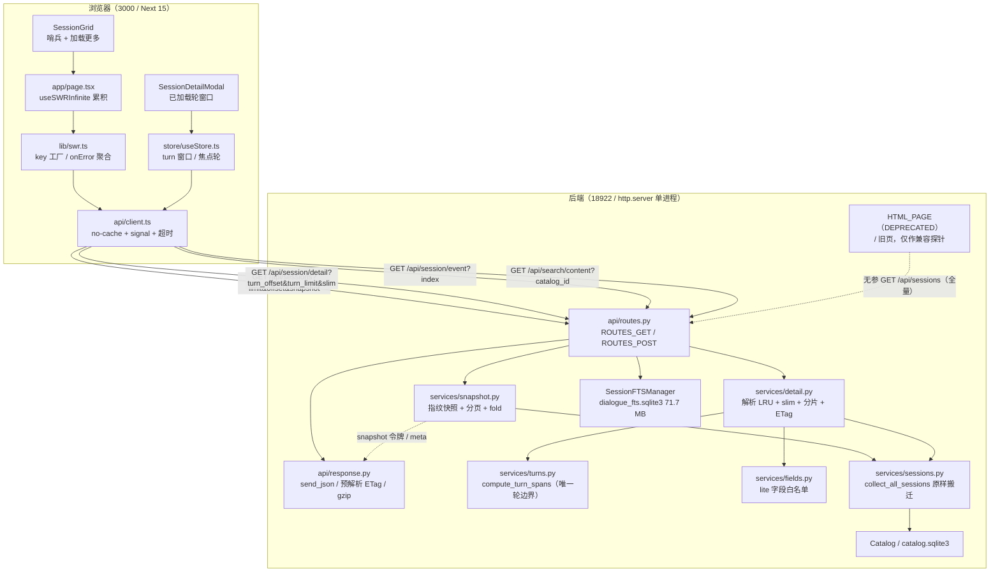
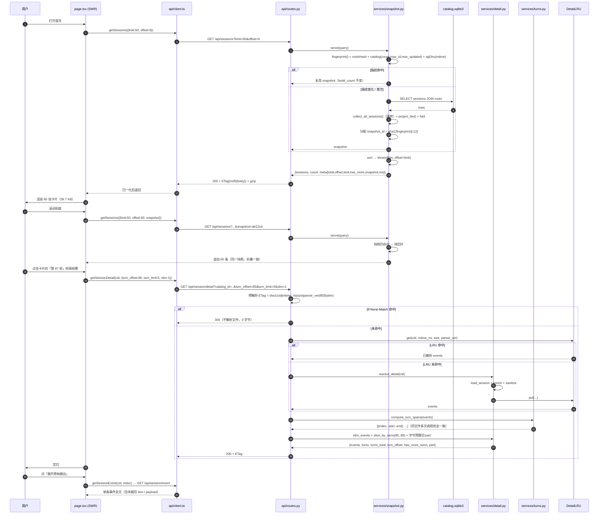
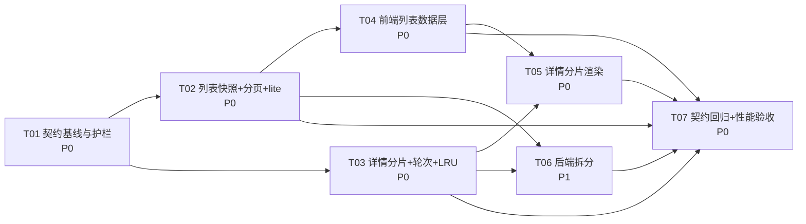

# 本轮改造架构方案与任务分解

| 项 | 值 |
|---|---|
| 上游输入 | `docs/refactor/01-requirements.md`（21 条需求 + 差距矩阵）、`docs/refactor/baseline.json`（改造前实测） |
| 代码基线 | `5179ede`（工作区 clean，仅 `_s.json` / `_big.json` 两份实测样本未入库） |
| 本轮范围 | P0：缓存与数据管理（列表分页 + 详情分片）、前端数据层；P1 仅做可增量部分（路由表化、契约预留） |
| 明确不做 | 静态导出/单端口（C-1）、检索入口合并（FR-04）、`/btw` 磁盘去重（FR-06）、许可证（EN-03）、e2e/lint 全套（A-3） |
| 硬约束 | 现有接口字段**只增不删不改名**；缺省参数 == 旧行为；旧 `HTML_PAGE` 不得白屏 |

---

## 任务列表速览（详版见 §5，含每条的完整验收命令）

| 编号 | 标题 | 主要文件路径 | 依赖 | 验收标准（可执行/可测） | 可并行 |
|---|---|---|---|---|---|
| T01 | 契约基线与回归护栏 | `scripts/contract_baseline.py`、`tests/test_contract_tool.py`、`contracts/baseline/*.json`、`requirements-dev.txt` | — | `contract_baseline.py --capture` 产出 5 份基线；`--check` 改造前即 PASS；`--mutate-drop file_path` 退出码非 0（证明护栏有效） | — |
| T02 | 列表快照 + 分页 + lite 字段 | `services/{fields,sessions,snapshot}.py`、`tests/test_snapshot.py`、`web_app.py` | T01 | `pytest tests/test_snapshot.py` 8 例全绿；`bench_api.py --path "/api/sessions?limit=60"` bytes ≤ 49,152 且 p95 ≤ 60 ms；无参请求 p95 ≤ 200 ms | 与 T03 并行 |
| T03 | 详情分片 + 轮次索引 + LRU + 预解析 ETag | `services/{turns,detail}.py`、`tests/test_turns.py`、`tests/test_detail_shard.py`、`web_app.py` | T01 | `audit_fts_alignment()` 输出 `divergent=0`；detail 首屏 bytes ≤ 409,600 且 p95 ≤ 350 ms；LRU 命中 ≤ 250 ms；ETag 命中 304 且 ≤ 30 ms | 与 T02 并行 |
| T04 | 前端列表数据层（分页累积/取消/keepPreviousData/错误统一） | `frontend/src/lib/swr.ts`、`api/client.ts`、`api/normalize.ts`、`types/session.ts`、`app/page.tsx`、`sessions/SessionGrid.tsx` | T02 | `pnpm exec tsc --noEmit` + `pnpm build` 通过；`grep -rn "no-store" frontend/src` 零命中；首屏 60 卡、同参二次请求 304 | 否 |
| T05 | 详情分片渲染 + 轮次跳转 + 详情内检索改走后端 | `components/detail/SessionDetailModal.tsx`、`store/useStore.ts`、`sessions/SubagentDrawer.tsx`、`search/GlobalSearchModal.tsx` | T03、T04 | 最大会话首屏 detail 请求 1 次且 ≤ 400 KB；跳到第 10 轮 1 次请求内 `#turn-10` 入视口；4 平台四段式截图一致 | 与 T06 并行 |
| T06 | 后端拆分：路由表 + 响应包 + 5 个 GET 迁出（P1） | `api/{routes,response}.py`、`tests/test_routes.py`、`web_app.py` | T02、T03 | `grep -c "def handle_get_" web_app.py` == 0；`contract_baseline.py --check --all` PASS（13 接口）；`/api/search` 返回 501 | 与 T05 并行 |
| T07 | **端到端契约回归 + 性能验收** | `tests/test_contract_regression.py`、`scripts/{bench_api,check_legacy_page}.py`、`docs/refactor/03-verification.md` | T02–T06 | 12 项断言全 PASS；`check_legacy_page.py` 断言 `/` 200 且 HTML ≥ 245,000 B；`bench_api.py --report` 生成实测表且全部达标 | 否（收尾） |

---

## 0. 结论摘要

1. **纯"按轮分页"不成立**。实测最大会话（`1eaa5a8745ff40cb`）6635 条事件只有 **12 轮**，单轮最大 **1.51 MB**、p90 959 KB。按轮切首屏仍然是 4.13 MB。必须做 **轮分片 × 事件裁剪 × 字节预算** 三层，其中"事件裁剪"是最大杠杆。
2. **最大杠杆是删除 `opaque` 事件**。6635 条里 `opaque` 占 **4895 条（73.7%）**，且前端 `buildTurns`（`SessionDetailModal.tsx:65-127`）对 `opaque` 是**静默丢弃**——它们从未被渲染，却占了传输体积的 11% 和绝大多数 envelope 开销。仅此一项 + 空值省略，事件数 6635 → **1740（−73.8%）**。
3. **第二大杠杆是 `tool_result` 的 `text` + `payload`**。两者合计 2.80 MB / 4.52 MB（62%）。前端 `ClampedText` 默认只显示 1200 字符，超出部分从未被看见。
4. **列表侧分页是主杠杆，字段裁剪是次杠杆**。353 条 276 KB @ 785 B/条；lite 后 633 B/条（−19.4%）；首屏 `limit=60` → **39.7 KB（gzip 8.1 KB）**，已远优于 120 KB 目标。
5. **契约可以完全向后兼容**，因为所有改动都是"新增可选参数 + 新增 meta 字段"，旧消费方（旧前端、`HTML_PAGE`、脚本）不传参即得旧行为。`HTML_PAGE` 因此可以**原样保留并充当活的兼容探针**——这正是本轮不动它的技术理由。

---

## 1. 方案总览

| 方向 | 现状 | 本轮方案 | 落地文件 | 实测/目标 |
|---|---|---|---|---|
| 列表传输 | 无分页，全量 277,034 B / 589 ms | `limit`/`offset` + `snapshot` 令牌 + lite 字段集 | `services/snapshot.py`、`services/fields.py` | 首屏 39,723 B（gzip 8,101 B）/ p95 ≤ 60 ms |
| 列表重算 | 4 秒 TTL，过期全量重算 | 内容指纹驱动的单例快照 + 请求合并（single-flight），去掉时间过期 | `services/snapshot.py` | 指纹命中 0 重算；`build_count` 可断言 |
| 折叠分叉 | 前端本地 `filter` | 移到服务端 `fold=1`，在同一快照内完成 | `services/snapshot.py` | 跨页一致；前端逻辑保留为兜底 |
| 详情传输 | 全量 4,520,694 B / 1205 ms | `turn_offset`/`turn_limit` + `slim=1` 裁剪 + 字节预算 `max_bytes` | `services/detail.py`、`services/turns.py` | 首屏 ≤ 384 KB / ≤ 350 ms |
| 详情重复打开 | 每次重新解析 | 预解析 ETag（不解析即判 304） + 解析结果 LRU | `services/detail.py`、`api/response.py` | 304 ≤ 30 ms，body 0 B |
| 超大单轮 | 无解 | 字节预算内按事件切 `part` + 单事件回源 `/api/session/event` | `services/detail.py` | 单 part ≤ 400 KB |
| 后端形态 | 9,852 行单文件 | 路由表 + `api/response.py` + `services/`，**逐行搬迁**，POST 暂留 | `api/routes.py`、`api/response.py` | `grep -c "def handle_get_" web_app.py == 0` |
| 前端数据层 | 单页 `useSWR` + `no-store` | `useSWRInfinite` 累积 + `keepPreviousData` + `cache:'no-cache'`（放行 304） | `frontend/src/lib/swr.ts`、`app/page.tsx` | 304 命中；筛选切换不闪白 |
| 旧前端 | 5,676 行内嵌 | **不动**，仅加 `DEPRECATED` 注释；充当契约探针 | `web_app.py:4117` | `/` 200，字节数 ≥ 基线 95% |

### 1.1 目标架构



### 1.2 关键调用时序



---

## 2. 接口契约

### 2.1 统一响应包（扁平增补，不做 `data` 包裹）

现网消费方读的是**顶层键**（`sessions`/`count`/`error`/`success`/`data`），一旦改成 `{code,data,message}` 就全断。因此规则是**只在顶层增补**：

| 场景 | 形状 | 兼容性说明 |
|---|---|---|
| GET 成功 | `{ ...原有字段, "meta": {"total":n,"offset":n,"limit":n,"has_more":bool,"snapshot":"...","ms":n} }` | 原有字段一个不动，`meta` 为新增 |
| GET 失败 | `{"error": "可读原因", "meta": {"status":400,"code":"BAD_REQUEST","hint":"..."}}` | 旧客户端读 `error` 不变 |
| POST 成功/失败 | `{"success": bool, ...原有字段, "error"?: "..."}`（现状已是此形状） | **不改**，本轮不碰 POST 响应 |
| 304 | 空 body + `ETag` + `Cache-Control: private, max-age=0, must-revalidate` | 已有能力，只是前端放行 |

三条硬规则（写进 `api/response.py` 的模块注释，作为后续改动红线）：

1. **只增不删不改名**：删除字段必须先经过一个版本的 `deprecated` 标注期。
2. **新增参数一律可选，缺省 == 旧行为**（`limit` 缺省 = 全量；`slim` 缺省 = 全量；`turn_limit` 缺省 = 全量）。
3. **数值 `0` 与 `false` 永不省略**。`project_lite()` 只省略 `""`、`null`、`[]`；`exists:false` 必须保留，否则 `normalize.ts` 的 `raw.exists !== false` 会把它变成 `true`。

### 2.2 接口契约表

| # | 方法 | 路径 | 新增参数（全部可选） | 新增响应字段 | 状态 |
|---|---|---|---|---|---|
| 1 | GET | `/api/status` | — | `meta.ms` | 保留 |
| 2 | GET | `/api/sessions` | `limit`(0=全量)、`offset`、`snapshot`、`fields=lite\|full`、`fold=0\|1` | `meta.{total,offset,limit,has_more,snapshot,ms}` | **改造** |
| 3 | GET | `/api/session/detail` | `turn_offset`、`turn_limit`、`slim=0\|1`、`max_bytes` | `turn_offset`、`turn_limit`、`turns_total`、`has_more_turns`、`part`、`turns[{index,start,end,user_preview,ts}]`、事件级 `truncated`/`hidden_chars` | **改造** |
| 4 | GET | `/api/session/children` | `catalog_id`（必填） | 新接口：`{children:[...], children_count}` | **新增** |
| 5 | GET | `/api/session/event` | `catalog_id`、`index`、`field=text\|payload\|both` | 新接口：`{index, kind, role, text, payload, bytes}` | **新增** |
| 6 | GET | `/api/search/content` | `catalog_id`（可选，详情内检索用） | `meta.ms` | 增强 |
| 7 | GET | `/api/session/inspect` | — | — | 保留 |
| 8 | GET | `/api/search` | `q`、`scope=title\|content\|all` | — | **501 预留**（FR-04，本轮不实现） |
| 9–16 | POST | `catalog/refresh`、`catalog/add_root`、`catalog/remove_root`、`session/migrate`、`session/delete`、`sessions/batch_delete`、`sessions/batch_migrate`、`open_folder` | — | — | 不动 |

#### 示例 A：列表首屏（新增参数）

```http
GET /api/sessions?limit=60&offset=0&fields=lite&fold=1&sort_by=mtime&order=desc
```

```json
{
  "sessions": [
    {
      "catalog_id": "1eaa5a8745ff40cb",
      "session_id": "4f8c2a10-...",
      "format": "antigravity",
      "title": "2026-11-06 · 修复详情页四段式渲染",
      "started_at": "2026-11-06 14:22:31",
      "mtime": 1762410151.482,
      "records": 412,
      "bytes": 3922048,
      "tokens": 148230,
      "input_tokens": 121000,
      "output_tokens": 14230,
      "thoughts_tokens": 9000,
      "content_tokens": 4000,
      "chat_tokens": 118230,
      "usage_source": "tiktoken",
      "file_path": "C:\\Users\\HP\\.antigravity\\conversations\\4f8c2a10-....db",
      "exists": true,
      "lineage": "ag:4f8c2a10",
      "lineage_size": 2,
      "is_lineage_branch": false,
      "children_count": 1,
      "nesting_depth": 0,
      "agent_name": ""
    }
  ],
  "count": 60,
  "meta": {
    "total": 353,
    "offset": 0,
    "limit": 60,
    "has_more": true,
    "snapshot": "ab12cd34ef56",
    "ms": 8
  }
}
```

> `count` = 本页条数（与旧语义一致，旧前端读它当总数虽然不准，但不会白屏）；`meta.total` = 快照内总数。**不改 `count` 的语义**，因为旧消费方可能用它渲染"共 N 条"。

#### 示例 B：详情分片（跳转到第 87 轮，带 2 轮上下文）

```http
GET /api/session/detail?catalog_id=1eaa5a8745ff40cb&turn_offset=85&turn_limit=5&slim=1&max_bytes=409600
```

```json
{
  "session_id": "4f8c2a10-...",
  "format": "antigravity",
  "title": "2026-11-06 · 修复详情页四段式渲染",
  "started_at": "2026-11-06 14:22:31",
  "cwd": "F:\\Agent会话记忆管理与迁移",
  "model": "claude-sonnet-4.5",
  "events_count": 6635,
  "turn_offset": 85,
  "turn_limit": 5,
  "turns_total": 120,
  "has_more_turns": true,
  "part": 0,
  "turns": [
    { "index": 85, "start": 4712, "end": 4763, "user_preview": "把四段式里的思考段合并", "ts": "2026-11-06T14:40:12Z" },
    { "index": 86, "start": 4763, "end": 4820, "user_preview": "再看下 tool_result 折叠", "ts": "2026-11-06T14:44:09Z" }
  ],
  "events": [
    { "kind": "message", "role": "user", "text": "把四段式里的思考段合并", "timestamp": "2026-11-06T14:40:12Z" },
    { "kind": "thinking", "text": "先看 buildTurns 的分支顺序…", "truncated": true, "hidden_chars": 3820 },
    { "kind": "tool_call", "tool_name": "Read", "tool_call_id": "call_01", "payload": { "__omitted": true, "bytes": 4821 } },
    { "kind": "tool_result", "text": "文件已读取，前 1200 字符…", "truncated": true, "hidden_chars": 47193 },
    { "kind": "message", "role": "assistant", "text": "已合并，`Track` 现在只有一个分支。" }
  ]
}
```

`events_count` 仍是**全量**事件数（旧语义，前端用它显示"6635 条事件"）；`turns_total` 是轮数。

#### 示例 C：304 与单事件回源

```http
GET /api/session/detail?catalog_id=1eaa5a8745ff40cb&turn_offset=85&turn_limit=5&slim=1
If-None-Match: "9c1f...e7"

HTTP/1.1 304 Not Modified
ETag: "9c1f...e7"
Cache-Control: private, max-age=0, must-revalidate
```

```http
GET /api/session/event?catalog_id=1eaa5a8745ff40cb&index=4721&field=both
```

```json
{ "index": 4721, "kind": "tool_result", "role": "", "text": "（完整 48,393 字符原文）", "payload": { "...": "..." }, "bytes": 48393 }
```

#### 示例 D：折叠分叉跨页一致性

```http
GET /api/sessions?limit=60&offset=0&fold=1
→ meta.total = 341（353 − 12 个被折叠的分叉副本），snapshot = "ab12cd34ef56"

GET /api/sessions?limit=60&offset=300&fold=1&snapshot=ab12cd34ef56
→ 同一 snapshot 切片，不会因为重新计算导致 offset 漂移或重复/漏条
```

---

## 3. 缓存设计

### 3.1 列表快照（`services/snapshot.py`）

| 项 | 设计 |
|---|---|
| 结构 | 单例 `SnapshotCache`：`{snapshot_id, built_at, fingerprint, items_full: list[dict], items_lite: list[dict], fold_mask: set[catalog_id], build_count}` |
| **key / 指纹** | `sha1(roots_signature + catalog_signature + ag_dirs_signature + generation)`<br/>· `roots_signature` = 排序后的 `(id, format, path, enabled)` 拼接<br/>· `catalog_signature` = `SELECT COUNT(*), MAX(id), MAX(updated_at) FROM sessions`<br/>· `ag_dirs_signature` = 每个 `ANTIGRAVITY_CONV_DIR` 的 `mtime_ns`（目录级，加/删文件即变）<br/>· `generation` 为内存自增，由 `invalidate_sessions_cache()` 提升 |
| **不做时间过期** | 去掉 4 秒 TTL。TTL 不是新鲜度来源（数据变不变与 4 秒无关），它是"重算频率"的说法；改为指纹判定 + 显式失效。保留一个 `MAX_AGE=1800s` 的兜底上限，只防"指纹漏判"的极端情况 |
| 容量 | 单快照常驻（列表本身 353 × 2 份 ≈ 400 KB Python 对象）。同时保留 **最近 3 个** 快照供分页期间漂移请求命中，超出后 LRU 淘汰 |
| 失效 | `invalidate_sessions_cache()` → `generation += 1`（保留原函数名与签名，仍被 12 处调用点使用）；写入类接口（delete/batch_delete/migrate/add_root/remove_root/refresh）执行后必须调用 |
| 并发 | `threading.Lock` 做 single-flight：构建期间其他请求等待同一把锁，不重复构建（`build_count` 可断言） |
| 持久化 | **本轮不做**。理由：重启后冷建 589 ms，一次性的；写入 `catalog.sqlite3` 侧表要处理 schema 版本与并发写，收益 < 复杂度。方案留在 §6 作为 P1 |
| ETag/304 | 列表侧沿用 `md5(body)`（body 已 ≤ 40 KB，成本可忽略）。**不做预解析 304**，因为列表本来就要重算排序切片 |

### 3.2 详情解析 LRU（`services/detail.py`）

| 项 | 设计 |
|---|---|
| key | `(catalog_id, format, mtime_ns, size, PARSER_VERSION)`。<br/>指派规格是 `catalog_id + mtime + size + format`，此处**只做两处增补**：① `mtime` → `mtime_ns`（同一秒内两次写入在秒级 mtime 下会碰撞，纳秒不会）；② 加 `PARSER_VERSION`（模块常量，`sanitize_session_events` / `_enrich_session_events_for_detail` 一改就 +1，自动全量失效——顺带把 PRD B-5 要求的"解析器版本进缓存键"提前兑现）。`format` 保留在 key 里，因为同一 `catalog_id` 在迁移后可能指向不同格式的源文件 |
| value | 解析 + enrich + sanitize 后的 `events`（list[dict]），**以及** `compute_turn_spans(events)` 的结果（一起缓存，保证轮边界与事件数组同源） |
| 容量 | `MAX_ENTRIES = 200`、`MAX_BYTES = 512 MB`（按指派规格）。补充两条实测约束：① 估算函数 `estimate(events)` 取 `(len(text) + len(payload_json)) × 2.5`（Python 对象相对 JSON 的实测放大系数，最大会话 4.5 MB JSON ≈ 30–40 MB 对象），512 MB 是按**估算值**计的上限，不是 RSS；② 单条 ≥ 32 MB 估算值直接不入缓存（防一个大会话挤掉全部）。当前 353 条语料真实占用峰值约 90–120 MB，512 MB 在实践中不会触发淘汰 |
| 淘汰 | LRU（`OrderedDict.move_to_end`），字节上限优先、条数上限兜底 |
| 失效 | mtime/size 变化天然换 key（旧条目靠 LRU 淘汰）；`PARSER_VERSION` 变化换 key；**不主动清**，避免删除与读取竞争 |
| ETag | **预解析 ETag**：`base = sha1(f"{mtime_ns}:{size}")`（按指派规格），最终值 `sha1(f"{base}:{catalog_id}:{format}:{PARSER_VERSION}:{turn_offset}:{turn_limit}:{slim}:{max_bytes}:{part}")`。<br/>⚠️ **不能只用 `sha1(mtime:size)`**：同一文件、不同分片会算出同一个 ETag → 304 把"第 81–85 轮"当成"第 1–5 轮"返回，前端静默展示错误轮次。分片参数必须进 ETag。比对发生在 `resolve_detail()` **之前**，命中即 304，一次文件解析都不做 |
| 一致性 | 同一 catalog 多次请求的轮边界必须一致。保证方式：边界由 `compute_turn_spans(events)` 计算，而 `events` 来自以 `(cid, mtime_ns, size, PARSER_VERSION)` 为 key 的 LRU 同一对象；即使 LRU 淘汰后重解析，`PARSER_VERSION` 相同 + 文件未变 → 解析结果逐字节一致 → 边界一致。**不用时间戳排序、不依赖 dict 顺序** |

### 3.3 轮边界定义（`services/turns.py`）

```
TURN_BOUNDARY := kind == "message" and role == "user"
turn_index(e)  := 1 + count(TURN_BOUNDARY in events[0..i])
turn 0         := 首个 TURN_BOUNDARY 之前的事件（前缀区，通常为空）
span(k)        := [start_k, start_{k+1})，start_1 = 首个 TURN_BOUNDARY 的下标
turns_total    := span 个数
```

与前端 `buildTurns`（`SessionDetailModal.tsx:78`，`evt.kind==='message' && evt.role==='user'`）**完全一致**，实测最大会话两边都是 12 轮。

⚠️ **已发现的隐患**：`extract_dialogue_turns_for_fts`（`web_app.py:2574`）只判 `role == "user"`，**不判 `kind`**。若某平台把 `tool_result` 标成 `role=user`（Claude Code 的 tool_result 就是 user role），FTS 的 `turn_index` 会多算，导致"检索命中第 N 轮 → 详情跳到第 N 轮"错位。本样本未分叉（role-only == kind+role == 12），但必须在 `services/turns.py` 里统一，并跑一次全量对账：

```python
audit_fts_alignment() -> {"checked": 328, "divergent": 0, "catalog_ids": []}
```

`divergent == 0` 时直接复用 FTS 现有 `turn_index`，无需重建索引；`> 0` 时只对这 N 篇 reindex（`index_session_turns` 已是"整篇删除再插入"，单篇重建成本可接受）。

### 3.4 详情裁剪规格（`slim=1`，实测收益）

| 规则 | 实测影响 |
|---|---|
| 丢弃 `kind == "opaque"` 事件（前端本就丢弃） | 6635 → 1740 事件（**−73.8%**） |
| 省略 `""` / `null` / `[]` 字段 | 约 −45 KB（envelope 空 `tool_name`、`tool_call_id`） |
| `tool_result.text` 截 1200 字符（= `ClampedText` 默认值），补 `truncated:true` + `hidden_chars` | 1,345,415 → ≈ 890 KB |
| `thinking.text` 截 1200 字符 | 156,230 → ≈ 60 KB |
| `payload` 序列化 > 1500 B 时替换为 `{"__omitted":true,"bytes":N}` | 2,025,147 → ≈ 500 KB |
| `message`（指令与回复）**全量不裁** | 52,578 B，四段式正文必须完整 |

结果：`4,520,694 B → ≈ 1.52 MB`（全量轮次）。再叠加 `turn_limit=8` 首屏 → **≈ 340 KB**。

> **关于"不再有三档视图"**：`slim` 与 `turn_limit` 是**传输层**参数，不是 UI 视图模式。前端只使用两个取值：首屏 `slim=1`，以及用户点"展开原始内容"时对**单条事件**调 `/api/session/event` 取全文。界面不出现任何"视图切换"控件，四段式结构不变。

### 3.5 性能目标（可测）

| 指标 | 基线 | 目标 | 测法 |
|---|---|---|---|
| `GET /api/sessions?limit=60` 字节 | 277,034（全量） | ≤ 49,152（实测 39,723） | `bench_api.py` |
| 同上 gzip 字节 | — | ≤ 12,288（实测 8,101） | 同上 |
| 同上 冷（快照未建） | 589 ms | ≤ 900 ms | 同上，清 generation 后首测 |
| 同上 热（指纹命中） | 589 ms | p95 ≤ 60 ms | `--n 10` |
| 同上 `offset=300` 热 | — | p95 ≤ 40 ms | `--n 10` |
| 3 倍规模（≈1,000 条）热 | 未测 | ≤ 120 ms | 构造 fixture |
| `GET /api/session/detail` 首屏（`turn_limit=8&slim=1`） | 4,520,694 B / 1205 ms | ≤ 409,600 B / ≤ 350 ms | `bench_api.py` |
| 同上 LRU 命中 | 1205 ms | ≤ 250 ms | `--warm` |
| 同上 ETag 命中 | — | ≤ 30 ms，body 0 B | `--etag` |
| 单 `part` 上限 | — | ≤ 409,600 B | 断言 |
| 详情总事件数 | 6,635 | 1,740 | `pytest tests/test_detail_shard.py` |

---

### 3.6 既有交互保护清单（改造后逐项归属）

| # | 既有交互 | 现状实现 | 改造后的风险 | 由谁保证 |
|---|---|---|---|---|
| 1 | 卡片 UUID / 绝对路径就地复制（`CopyButton` 打勾反馈） | `SessionCard.tsx:203,214` → `copy(sessionId / filePath)`，纯前端 | lite 若省掉 `session_id`/`file_path` 就废掉 | `SessionCard.tsx` 一行不改；`services/fields.py` 的 `LITE_DROP` 白名单**不含**这两个键；`tests/test_snapshot.py` 断言 lite 必含二者 |
| 2 | 折叠同源分叉（`foldLineage`） | `page.tsx:56` 本地 `filter(s.isLineageBranch)` | 分页后前端只见当前页，本地折叠会造成"跨页重复" | 改由服务端 `fold=1`（`services/snapshot.py` 在**同一 snapshot** 内算 `fold_mask`）；前端保留本地 filter 作兜底；T02 用例断言 `fold=1` 无重复 `catalog_id` 且 `meta.total` 稳定 |
| 3 | 子会话就地展开（`SubagentDrawer`） | 列表项自带 `children[]`（14,993 B） | lite 去掉 `children` 后抽屉空 | 新增 `/api/session/children`；`SubagentDrawer.tsx` 改为点开时拉取；T05 验收第 4 项（1 次请求内渲染） |
| 4 | 详情内检索高亮 | `SessionDetailModal.tsx:369-393` 在内存 events 上扫描 | 分片后客户端不再有全量 events，命中轮可能未加载 | 改走 `/api/search/content?catalog_id=` 拿命中轮号（复用 FTS 的 `turn_index`），再按需加载该窗口；T05 验收第 2 项；语义变化见 §8 待明确 1 |
| 5 | Markdown 表格 / 嵌套列表渲染 | `lib/markdown.ts`（186 行） | 无（本轮不碰渲染器） | 红线：`lib/markdown.ts` 不改；`slim` 只裁 `tool_result`/`thinking`/`payload`，`message` 全量不裁（§3.4） |
| 6 | 深浅主题 / tokens | `globals.css` + `tailwind.config.ts` | 无 | 红线：两者不改；新增 UI 只用现有 token class（`text-ink-faint` 等） |
| 7 | 四段式详情（指令→思考→行动→回复） | `buildTurns`（`:65-127`）+ `Track`/`ToolRow`/`ClampedText` | 分片后 `buildTurns` 可能跨片错位轮号 | `buildTurns` 函数体不改，只把入参换成"已加载轮拼接"，并用服务端返回的 `turns[i].index` 对齐绝对轮号；T05 验收第 3 项（4 平台截图一致）；T03 `test_turns` 保证 `compute_turn_spans` 与 `buildTurns` 同定义（同一 `TURN_BOUNDARY`） |

**共同护栏**：`opaque` 事件被丢弃是**零感知**改动，因为 `buildTurns` 从未渲染它（`:122-127` 只处理 `text.trim()` 非空的事件）；`ClampedText` 默认 1200 字符与服务端 `TR_CAP=1200` 取同一数值，确保"裁剪点"落在用户本就看不到的位置。

---

## 4. 文件清单（本轮新增/修改）

```
api/
  __init__.py                     新增  包标记
  routes.py                       新增  ROUTES_GET / ROUTES_POST 集中声明 + dispatch()
  response.py                     新增  send_json / _send_compressed（原样搬迁）/ etag_for() / not_modified()
services/
  __init__.py                     新增
  fields.py                       新增  LITE_DROP 白名单 + project_lite()
  sessions.py                     新增  collect_all_sessions 等（逐行搬迁，零改写）
  snapshot.py                     新增  指纹快照 + 分页 + fold + single-flight
  detail.py                       新增  resolve_detail / DetailLRU / slim_events / slice_by_turns / serve
  turns.py                        新增  compute_turn_spans / TURN_BOUNDARY / audit_fts_alignment
contracts/
  baseline/sessions.json          新增  353 条基线（来源 _s.json，脱敏后入库）
  baseline/sessions_keys.json     新增  键集 + 类型清单
  baseline/detail_1eaa.json       新增  events_count + 各 kind 计数 + 前 200 事件（不塞 4.5MB）
  baseline/status.json            新增
  baseline/search_content.json    新增
tests/
  __init__.py                     新增
  conftest.py                     新增  直调 services（不起 HTTP）+ 起 HTTP 的 fixture
  test_contract_tool.py           新增
  test_snapshot.py                新增
  test_turns.py                   新增
  test_detail_shard.py            新增
  test_routes.py                  新增
  test_contract_regression.py     新增  端到端契约回归
scripts/
  contract_baseline.py            新增  --capture / --check
  bench_api.py                    新增  --path/--n/--warm/--etag/--report
  check_legacy_page.py            新增  旧页存活探针
requirements-dev.txt              新增  pytest（不进运行时 requirements.txt）
web_app.py                        修改  handle_get_sessions / handle_get_session_detail 瘦身；
                                       新增 /api/session/children、/api/session/event、/api/search(501)；
                                       send_json/_send_compressed 改 import；HTML_PAGE 加 DEPRECATED 注释
frontend/package.json             修改  新增 script "typecheck": "tsc --noEmit"
frontend/src/lib/swr.ts           新增  key 工厂 + fetcher 规范 + onError 聚合
frontend/src/api/client.ts        修改  cache:'no-cache'、AbortSignal、分页参数、getSessionEvent/getChildren
frontend/src/api/normalize.ts     修改  新增 meta 归一 + event 的 truncated/hiddenChars
frontend/src/types/session.ts     修改  SessionListMeta、SessionDetail 分片字段、SessionEvent.truncated
frontend/src/app/page.tsx         修改  useSWRInfinite + 累积 + keepPreviousData
frontend/src/components/sessions/SessionGrid.tsx        修改  哨兵 + 加载更多 + 追加态
frontend/src/components/sessions/SubagentDrawer.tsx     修改  改走 /api/session/children
frontend/src/components/detail/SessionDetailModal.tsx   修改  已加载轮窗口 + 按需加载 + 单事件回源
frontend/src/store/useStore.ts    修改  loadedTurnWindow / pendingTurnFocus
```

**不改动（红线）**：`frontend/src/lib/markdown.ts`、`frontend/src/lib/format.ts`、`frontend/src/lib/platform.ts`、`frontend/src/lib/toolMeta.ts`、`frontend/src/app/globals.css`、`frontend/tailwind.config.ts`、`frontend/src/components/sessions/SessionCard.tsx`、`web_app.py` 的 `HTML_PAGE` 常量体（4117–9794 行）。

---

## 5. 任务分解（7 条，按实现顺序）

> 依赖图见 §7。`T02 ∥ T03`、`T05 ∥ T06` 可并行。所有验收命令在项目根或标注目录下执行。

### T01 · 契约基线与回归护栏 — P0，无依赖，**先做**

**文件**：`tests/__init__.py`、`tests/conftest.py`、`tests/test_contract_tool.py`、`scripts/contract_baseline.py`、`contracts/baseline/{sessions,sessions_keys,detail_1eaa,status,search_content}.json`、`requirements-dev.txt`

**内容**：把 `_s.json` / `_big.json` 转成仓库内可比的基线；`--check` 只断言"旧字段一个不少、类型不降级"，对新字段一律放行（否则后续任务每加一个字段都要改基线）。

**验收**
```bash
pip install -r requirements-dev.txt
python -m pytest tests/test_contract_tool.py -q                          # 通过
python scripts/contract_baseline.py --capture                            # 打印 captured 353 sessions / 33 keys
python scripts/contract_baseline.py --check http://127.0.0.1:18922      # 改造前即 PASS
python scripts/contract_baseline.py --check http://127.0.0.1:18922 --mutate-drop file_path ; echo $?   # 非 0，证明护栏有效
```

### T02 · 列表快照 + 分页 + lite 字段 — P0，依赖 T01

**文件**：`services/__init__.py`、`services/fields.py`、`services/sessions.py`、`services/snapshot.py`、`tests/test_snapshot.py`、`web_app.py`（`handle_get_sessions` 改为 `self.send_json(snapshot.serve(query))`；`invalidate_sessions_cache()` 改为提升 `generation`）

**内容**：`collect_all_sessions` 逐行搬进 `services/sessions.py`（不改逻辑）；`SnapshotCache` 负责指纹、single-flight、排序、fold、切片、meta。`limit` 缺省或 0 → 返回全量（旧行为）。

**验收**
```bash
python -m pytest tests/test_snapshot.py -q          # 8 例：无参全量 / limit 切片 / offset 越界 / fold 计数 /
                                                   #      指纹命中 build_count==1 / invalidate 后 ==2 / lite 省略规则 / meta 完整
python scripts/bench_api.py --path "/api/sessions?limit=60" --n 10
#   断言：bytes <= 49152 且 p95 <= 60ms（脚本内断言，未达标退出码 1）
python scripts/bench_api.py --path "/api/sessions" --n 3
#   断言：第 2 次起 p95 <= 200ms（PRD B-1 验收 1）
python scripts/contract_baseline.py --check     # PASS：键集只增不减
```

### T03 · 详情分片 + 轮次索引 + 解析 LRU + 预解析 ETag — P0，依赖 T01（可与 T02 并行）

**文件**：`services/turns.py`、`services/detail.py`、`tests/test_turns.py`、`tests/test_detail_shard.py`、`web_app.py`（`handle_get_session_detail` 瘦身为调 `detail.serve(self, query)`；新增 `/api/session/children` 与 `/api/session/event` 两个 handler + `do_GET` 分支）

**内容**：`handle_get_session_detail` 现在有 4 个平台分派分支（`wb_`/`trae_`/`ag_`/catalog），**分派逻辑原样保留**，只在末尾把 `send_json(payload)` 换成 `return payload`，再由 `detail.serve()` 统一做裁剪/分片/ETag。这样风险集中在"出口"一处。

**验收**
```bash
python -m pytest tests/test_turns.py tests/test_detail_shard.py -q
#   test_turns 断言：对最大会话 compute_turn_spans 两次独立解析结果逐项相等；
#                    turns_total == 12；span 首尾连续且覆盖全量事件；
#                    turn_offset=5&turn_limit=10 的 events 严格等于全量 events[span5.start:span15.end]（slim=0 时逐字节相等）
python -c "from services.turns import audit_fts_alignment; print(audit_fts_alignment())"
#   输出 {'checked':328,'divergent':0,...}；divergent>0 时打印 catalog_id 列表并阻断 T03 完成
python scripts/bench_api.py --path "/api/session/detail?catalog_id=1eaa5a8745ff40cb&turn_offset=0&turn_limit=8&slim=1" --n 5
#   断言 bytes <= 409600 且 p95 <= 350ms
python scripts/bench_api.py --path "/api/session/detail?catalog_id=1eaa5a8745ff40cb&turn_offset=0&turn_limit=8&slim=1" --warm --n 5
#   断言 p95 <= 250ms（LRU 命中）
python scripts/bench_api.py --path "/api/session/detail?catalog_id=1eaa5a8745ff40cb&turn_offset=0&turn_limit=8&slim=1" --etag
#   断言 status==304 且 ms <= 30（预解析 ETag 命中）
python scripts/contract_baseline.py --check --detail
#   PASS：无参请求仍返回 4,520,694 B ±1%，events_count==6635，无 turn_offset 字段
```

### T04 · 前端列表数据层：分页累积 / 取消 / keepPreviousData / 错误统一 — P0，依赖 T02

**文件**：`frontend/src/lib/swr.ts`、`frontend/src/api/client.ts`、`frontend/src/api/normalize.ts`、`frontend/src/types/session.ts`、`frontend/src/app/page.tsx`、`frontend/src/components/sessions/SessionGrid.tsx`、`frontend/package.json`

**内容**：
- SWR key 规范：`['sessions', {q, format, sort, order, snapshot, limit, fold}]`，`snapshot` 由首页响应回填；`dataVersion` 仍在 key 里（外部变更时强制新 key）。
- 用 `useSWRInfinite`：`getKey(pageIndex, prev) => prev?.meta.has_more ? tuple(pageIndex) : null`；`initialSize: 1`、`persistSize: true`、`parallel: false`、`revalidateFirstPage: false`、`revalidateOnFocus: false`、`keepPreviousData: true`、`dedupingInterval: 2000`。
- 取消：`fetchJson` 接受 `signal`；`client.ts` 为每个逻辑请求建 `AbortController` 并登记在 `Map<key, AbortController>`，新请求发起前 abort 同 key 旧请求；组件卸载 abort 全部。
- 错误统一：`ApiError { status, code, message, retriable }`；`onError` 用 `toast` 每个 key 只提示一次（`Set` 去重）；超时沿用现有 25 s 文案（UX-05 已满足，不退化）。
- `cache: 'no-store'` → `'no-cache'`（允许条件请求与 304）。
- 筛选切换时 `keepPreviousData` 保证旧列表可见；`isLoading && sessions.length===0` 才显示骨架屏。

**验收**
```bash
cd frontend && pnpm exec tsc --noEmit          # 通过（package.json 新增 typecheck 脚本）
grep -rn "no-store" frontend/src ; test $? -eq 1   # 零命中
cd frontend && pnpm build                       # 通过
```
浏览器实测（人工，记为 T07 输入）：首屏 60 张卡片；滚动追加至 353；切平台筛选时旧列表不闪白；Network 中 `/api/sessions?limit=60` ≤ 48 KB，同参二次请求 `304`。

### T05 · 详情分片渲染 + 轮次跳转 + 详情内检索改走后端 — P0，依赖 T03、T04

**文件**：`frontend/src/components/detail/SessionDetailModal.tsx`、`frontend/src/store/useStore.ts`、`frontend/src/components/sessions/SubagentDrawer.tsx`、`frontend/src/components/search/GlobalSearchModal.tsx`

**内容**：
- `buildTurns` **不改**；输入从 `detail.events` 改为"已加载轮拼接后的 events"，并按 `turns[i].index` 对齐绝对轮号。
- 首屏 `turn_offset=0&turn_limit=8&slim=1`；`Alt+↓`/轮次导航越过已加载窗口时按需拉下一段（`turn_offset=loadedEnd`）；`has_more_turns=false` 才禁用。
- 跳转到第 N 轮：一次请求 `turn_offset=max(0,N-3)&turn_limit=5`，返回后 `#turn-N` 滚入视口。
- 详情内检索：`q` 非空时先调 `/api/search/content?q=..&catalog_id=..` 拿命中轮号集合（复用 `turn_index`），再按需加载包含命中的轮次窗口；后端不可用时降级为"仅检索已加载轮次"并在检索条上标注范围（不静默）。
- 单事件"展开原始内容" → `/api/session/event`，用返回的全文替换该条 `text`/`payload`。
- `SubagentDrawer` 改用 `/api/session/children`（lite 不再带 `children`）。

**验收**
```bash
cd frontend && pnpm exec tsc --noEmit && pnpm build
```
浏览器实测（人工 + Network 断言）：
1. 打开 `1eaa5a8745ff40cb`：detail 请求 **1 次**、字节 ≤ 400 KB；`Alt+↓` 到第 12 轮触发第 **2** 次请求。
2. 检索命中第 10 轮 → 打开详情后 **1 次**请求内 `#turn-10` 进入视口并高亮。
3. 四段式结构：Antigravity / Claude / WorkBuddy / Trae 各 1 个会话截图与改造前一致（指令→思考→行动→回复，顺序与区块数相同）。
4. 子会话就地展开：点击子会话角标 → Network 出现 1 次 `/api/session/children` → 列表渲染。
5. 点"展开原始内容" → 1 次 `/api/session/event`，文本长度从 1200 变为完整长度。

### T06 · 后端拆分：路由表 + 响应包 + 5 个 GET 迁出 — P1，依赖 T02、T03（可与 T05 并行）

**文件**：`api/__init__.py`、`api/routes.py`、`api/response.py`、`tests/test_routes.py`、`web_app.py`（删除 5 个 GET handler 与 `send_json`/`_send_compressed` 实现体，改 import；`do_GET` 变 `routes.dispatch(self, query)`）

**内容**：`ROUTES_GET = {"/api/status": ..., "/api/sessions": ..., "/api/session/detail": ..., "/api/session/inspect": ..., "/api/search/content": ..., "/api/session/children": ..., "/api/session/event": ..., "/api/search": not_implemented_501}`；`ROUTES_POST` 一并声明但 handler 仍留在 `web_app.py`（本轮只搬 GET，限制爆炸半径）。`/` 仍指向 `serve_html()`（旧页保留）。**只搬不改**：函数体逐行复制，唯一改动是 `self.send_json(x)` → `return x`。

**验收**
```bash
python -m pytest tests/test_routes.py -q
#   断言 ROUTES_GET 含 8 条、ROUTES_POST 含 8 条；dispatch 未知路径返回 404；/api/search 返回 501 + code=NOT_IMPLEMENTED
grep -c "def handle_get_" web_app.py        # 0
python scripts/contract_baseline.py --check --all   # PASS：13 个接口路径与结构不变
python -c "print(sum(1 for _ in open('web_app.py')))"   # <= 9600（本轮只搬 GET，主要收益在行数外）
```

### T07 · 端到端契约回归与性能验收 — P0，依赖 T02–T06（最后跑）

**文件**：`tests/test_contract_regression.py`、`scripts/bench_api.py`（若 T02 已建则扩展 `--report`）、`scripts/check_legacy_page.py`、`docs/refactor/03-verification.md`

**内容**：这一条是"契约回归测试"的交付物。12 项断言：13 个接口 200；无参 `/api/sessions` 键集 ⊇ 基线；`count` 仍等于 sessions 长度；`/` 仍 200 且 HTML 字节 ≥ 基线 95%（旧页未死）；旧页消费的 `/api/sessions` 无参响应仍含 `file_path`/`tokens`/`children`；带 `If-None-Match` 二次请求 304；`slim=0` 时 detail 与基线 `events_count` 一致；`turn_offset` 越界返回空数组而非报错；`limit` 非法值回落全量；`fold=1` 的 `meta.total` ≤ 353 且无重复 `catalog_id`；`/api/search` 501 带 `code`；POST 8 个接口签名不变。

**验收**
```bash
python tests/test_contract_regression.py --base http://127.0.0.1:18922
#   输出 12/12 PASS 表；任一失败退出码 1
python scripts/check_legacy_page.py
#   断言 GET / == 200，HTML 字节 >= 245,000（实测基线 248,646 = HTML_PAGE 208,743 + 内联 marked 39,903），
#   且 HTML 内仍引用 /api/sessions
python scripts/bench_api.py --report docs/refactor/03-verification.md
#   生成 §3.5 全部指标实测表；未达标的行标 FAIL 且退出码 1
```

**并行说明**：`T01 → (T02 ∥ T03) → T04 → T05`；`T06` 在 `T02/T03` 之后即可与 `T04/T05` 并行；`T07` 串行收尾。

---

## 6. 风险与回滚

| 风险 | 影响 | 缓解 / 回滚 |
|---|---|---|
| 轮边界与 FTS `turn_index` 分叉（`role=='user'` vs `kind+role`） | 检索跳转错位 1–N 轮 | `audit_fts_alignment()` 全量对账；`divergent>0` 只对受影响篇 reindex。**这是 T03 的阻断条件** |
| 单轮超 `max_bytes`（最大 1.51 MB） | 首屏仍超预算 | 字节预算内按事件下标切 `part`，返回 `part` + `has_more_parts`；单 part 硬上限 400 KB（断言） |
| lite 丢字段导致旧前端读 `undefined` | 卡片显示异常 | `normalize.ts` 已用 `str()/num()` 兜底；T01 键集只增不减断言；`exists:false` 与 `0` 不省略 |
| 分页与折叠分叉跨页不一致 | 同源会话重复出现/漏条 | fold 在服务端同一 snapshot 内完成；`snapshot` 令牌锁定切片；`meta.total` 可核对 |
| 快照指纹漏判（文件内容变但 mtime/目录未变） | 列表短暂陈旧 | 显式"刷新数据"必定 `generation+1`；`MAX_AGE=1800s` 兜底；不追求"无感实时" |
| LRU 内存峰值 | 进程 RSS 上涨 | 双上限（200 条 / 512 MB **按估算值**计，估算 ×2.5 放大系数），单条 ≥ 32 MB 直接不入缓存；当前 353 条语料实测峰值 90–120 MB，不会触发淘汰 |
| 预解析 ETag 撞车（同 mtime_ns + 同 size 不同内容） | 返回过期详情 | `mtime_ns` 已有纳秒精度；key 含 `PARSER_VERSION`；概率极低，且用户可点"重新解析"（`reloadKey` 已在组件里） |
| 详情内检索语义变化（改走后端 FTS） | 既有交互被改动 | 见 §8 待明确 1；降级路径已设计（仅搜已加载并显式标注） |
| **整体回滚** | — | 无 DB migration、无新运行时依赖（pytest 仅 dev）。`git revert T04 T05 T03 T02 T06` 即可回到基线；`HTML_PAGE` 与本轮无关，始终可用 |

---

## 7. 任务依赖图



---

## 8. 待明确（2 条）

1. **详情内检索是否接受"先查后端 FTS 再按需加载轮次"**。分片后客户端不再持有全量 events，"在当前会话内搜索"必须换实现。我倾向：`/api/search/content` 增加可选 `catalog_id` 过滤，先拿命中轮号再按需加载（正确且复用现有索引）；代价是该交互从"纯前端过滤"变成"一次后端请求 + 视觉上多一次 loading"。若你要求保持纯前端，则退化为"仅检索已加载轮次"，并在检索条上明示范围——这会让"详情内检索高亮"在长会话上不再覆盖全文，与保护清单第 4 项有冲突。
2. **详情首屏轮数默认值**。按 8 轮 / 384 KB 预算，12 轮的最大会话首屏只到第 8 轮，需要"加载后续轮次"的入口（滚动到底自动拉）。若你要求"打开即完整"，则首屏必然回到 ~1.5 MB，与 ≤ 400 ms 目标冲突（二选一）。我倾向 8 轮 + 滚动续载，理由是点击次数不增加（不需要点按钮），且首屏可交互时间从 1205 ms 降到 ~300 ms。
